# 语音信息处理 · PPT 原文对应

知识点正文引用 PPT 原文，公式保留局部原式。完整课件及框图通过对应页码查看。

## c1-b01 · 声音与语音

第1章 · PDF p.11、12

PDF p.12
声音与语音

◼声音(Sound)的定义（维基百科）

声音是振动产生的声波，是通过介质（空气、固体、液
体）传播并能被人或动物听觉器官所感知的波动现象。

◼语音（Speech）的定义

语音是声音的一种，是人在言语交流过程中由发音器官产
生和由听觉系统感知的语言载体。因此，语音信息处理的
研究，长期以来一直是围绕着人的发音（产生）和听觉
（感知）机理、及相关的语言学概念展开的。

注：当我们考虑有声语言（Spoken language）的“语言信息”时，
用“言语”的称谓，当把它作为物理信号进行处理时，称之为“语音”。
在不引起混淆的情况下，一般不做严格地区分。

PDF p.11
第一章语音产生与感知机理

◼1.1 语音产生的机理

□1.1.1 有声语言（语音）的形成（基本概念）

□1.1.2 语音的发音器官及其发音机理（基本概念）

□1.1.3 发音运动及其范畴化（基本概念）

◼1.2 语音感知的机理

◼1.3 语音产生与感知的相互作用

声音作为载体属于语音的生理物理特性，
承载的内容属于语音的社会特性

## c1-b02 · 声音的产生、传播与感知

第1章 · PDF p.13

PDF p.13
声音的产生、传播与感知

◼声音的产生

声音是由振动产生的，它引起介质（如空气等）粒子的
简谐（正弦规律）运动，形成波动。

◼声音的传播

空气分子的简谐振动，使周围的空气产生疏密变化，形
成疏密相间的纵波，进行传播。

◼声音的感知

耳蜗将中耳传来的机械运动转为淋巴液的波动，所含频率
在基底膜对应位置引起谐振将其分解并传入大脑进行感知。
语音感知过程会融入其他知识对声音进行综合判断。

## c1-b03 · 声音的产生

第1章 · PDF p.14、35、44

PDF p.14
声音的产生

◼两端关闭或开放的声管、两端固定的弦的谐振频率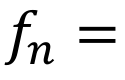 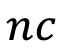

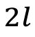

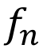为第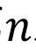次谐振频率，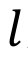为管长，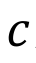为音速。

谐振频率现象是指一物理系统在特定频率和波长下，比其他
频率和波长以更大的振幅做振动的情形。

◼一端关闭另一端开放的声管或
一段固定另一端自由的谐振频率

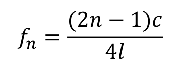

[查看课件图示 · p.14](../decks/ch1.pdf#page=14)

PDF p.35
元音的共振峰频率

共振峰=声道共振产生的波峰（同时受声源特性的影响）

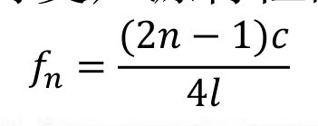

用单端封闭管中的驻波解释声道共振

在均匀管(上图)和均匀声道(下图)中最大音量流点(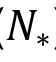)的分布 （Chiba & 
Kajiyama， 1942)

辅音一般没有共振峰，除非半元音可以被认为有共振峰

[查看课件图示 · p.35](../decks/ch1.pdf#page=35)

PDF p.44
外耳(Outer ear)

耳廓的形状可使频谱峰压
点在5.5 kHz的纯音提高
10分贝(dB)的增益。

外耳道长约2.5 cm，
常温下音速约为350 m/s

外耳道的初次和二次谐振频率大约为多少Hz？

初次谐振频率大约位于3.5 kHz附近，其2次谐振频率将达10 kHz前后。

◼外耳包括耳廓和外耳道，主要起集声的作用。

◼外耳道是声波传导的通路，一端开放，另一端由鼓膜封闭。

[查看课件图示 · p.44](../decks/ch1.pdf#page=44)

## c1-b04 · 声音的传播

第1章 · PDF p.15

PDF p.15
声音的传播

扩张

压缩

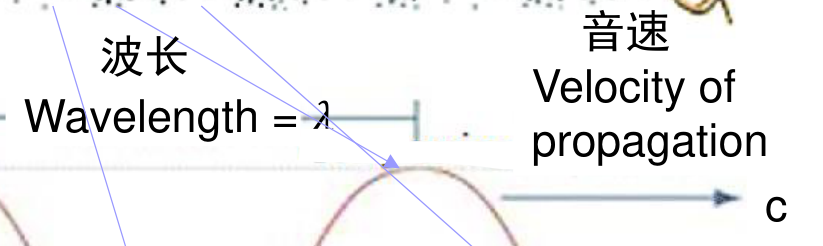

振幅（Amplitude）

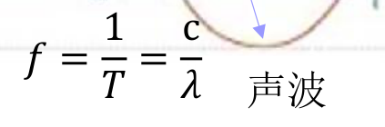

[查看课件图示 · p.15](../decks/ch1.pdf#page=15)

## c1-b05 · 语音的发音器官

第1章 · PDF p.19、21、22

PDF p.19
语音的发音器官

◼发音器官

肺、气管、喉（包括声带）、咽、鼻、
口。它们共同形成一条形状复杂的管道

◼声带（Vocal Cords） 10~14mm

在喉部的从喉结到杓状软骨之间的韧带褶

◼声门（Glottis）

两个声带之间形成一个开闭自如的声门

◼声道（Vocal Tract）
     由咽腔、口腔和鼻腔三个空气腔体组成

[查看课件图示 · p.19](../decks/ch1.pdf#page=19)

PDF p.21
声源（激励源）的产生

◼声源

□肺部产生气流，通过猴头时冲击声带，使声带产生振动

□能量：绝大多数来源于正常呼吸时肺部呼出的稳定气流

◼声带

□既是一个阀门又是一个振动部件

□呼吸时左右两声带打开（声门开）

□在说话的时候合拢，肺部气流经气管形成冲击“打开-闭

合-打开-闭合-…”声门，从而冲击声带产生振动，然后通
过声道响应变成语音

PDF p.22
声道调制

◼声道

□咽、口腔和鼻腔

□从声门延伸至口唇的非均匀截面的声管，约17cm（成年

男性）

◼功能

□谐振腔：放大某一频率而衰减其他频率分量

□谐振频率/共振频率（formant frequency）：当激励的频

率达到它声道的固有频率，则声道会以最大的振幅来振
荡（共鸣）。由每一瞬间的声道外形决定，又称为共振
峰，是声道的重要声学特征

## c1-b06 · 语音产生的原理图

第1章 · PDF p.20、21、22、23

PDF p.20
语音产生的原理图

◼人的发声过程包括两个步骤

□声门/声带产生不同频率的声音

准周期气流脉冲或白噪声

□声道对声源的调制作用

激励过程 调制过程

（声门） （声道）
语音辐射

[查看课件图示 · p.20](../decks/ch1.pdf#page=20)

PDF p.21
声源（激励源）的产生

◼声源

□肺部产生气流，通过猴头时冲击声带，使声带产生振动

□能量：绝大多数来源于正常呼吸时肺部呼出的稳定气流

◼声带

□既是一个阀门又是一个振动部件

□呼吸时左右两声带打开（声门开）

□在说话的时候合拢，肺部气流经气管形成冲击“打开-闭

合-打开-闭合-…”声门，从而冲击声带产生振动，然后通
过声道响应变成语音

PDF p.22
声道调制

◼声道

□咽、口腔和鼻腔

□从声门延伸至口唇的非均匀截面的声管，约17cm（成年

男性）

◼功能

□谐振腔：放大某一频率而衰减其他频率分量

□谐振频率/共振频率（formant frequency）：当激励的频

率达到它声道的固有频率，则声道会以最大的振幅来振
荡（共鸣）。由每一瞬间的声道外形决定，又称为共振
峰，是声道的重要声学特征

PDF p.23
调音

◼调音（Articulation）

为了发出各种各样的声音，需要调整声道的形状，称之为
调音

◼调音运动（Articulation Movement）

声道各部分的动作

◼调音器官（Articulation Organ）

调音用的声道的各部分器官，包括舌、颚、唇和嘴等声道
中可以自由活动的部分

## c1-b07 · 浊音、清音与爆破音

第1章 · PDF p.24

PDF p.24
浊音、清音与爆破音

◼浊音（voiced sounds）：声道打开，声带在先打开后关闭，

气流经过使声带要发生张驰振动，变为准周期振动气流。
浊音的激励源被等效为准周期的脉冲信号。

□如发/U/、/d/、/i/等音

◼清音（unvoiced sounds）：声带不振动，而在某处保持收

缩，气流在声道里收缩后高速通过产生湍流，再经过主声
道（咽、口腔）的调整最终形成清音。清音的激励源被等
效为一种白噪声信号。

□如发/∫/音

◼爆破音（plosive sounds）：声道关闭之后产生压缩空气然

后突然打开声道所发出的声音。

□如发/ t∫/音时

## c1-b08 · 语音的基本特性

第1章 · PDF p.26

PDF p.26
语音的基本特性

◼振幅（Amplitude）

□波振动的大小，一般用dB表示（声压级的标准测量单位）

◼基音周期（Pitch Period）

□声带开启-闭合一次的时间

◼基频（Pitch Frequency: F0）

□基音周期的倒数，声带振动的基本频率

◼音调

□声带振动的频率（即基音）决定了声音频率的高低，频

率快则音调高，否则音调低

□人的基音范围

◼80~500 HZ，儿童和青年女性偏高，成年男性偏低
26

## c1-b09 · 发音运动指令的范畴化

第1章 · PDF p.28

PDF p.28
发音运动指令的范畴化

◼舌头大约有8000个运动神经元单位

◼语音的发音姿势需要满足一定的条件

（1）发音姿势要简单易学；
（2）发音姿势要能够产生稳定的声学特性

◼人类的语音发音运动被范畴化和符号化，而动物（鸟类除

外）的叫声无法符号化；每一个范畴声学特征对应一组范
畴化的运动指令

◼发音运动指令的范畴化：一个相对独立的语音单元，即使

其发音姿势在一定范围内变动，其声学特性应该稳定不变。

## c1-b10 · 音素及音位的基本概念

第1章 · PDF p.29

PDF p.29
音素及音位的基本概念

◼人类有大约7000种语言，包括约200个元音和600个辅

□音素（Phone）：被范畴化成为生成上可区分的最小语音单元

□区分标准：物理和生理属性

◼但是，对于一种特定的语言，大约有40个音素

◼若干相近的音素归类为一个音位（Phoneme）

□音位：听觉上可以区分的最小语音单元

□区分标准：社会和语言属性
比如，汉语拼音中的z、c、s和zh、ch、sh在普通话中是两组不同的音
位，但在南方许多方言中它们是同一组音位

## c1-b11 · 语音生成上的最小语音单元：音素

第1章 · PDF p.24、30

PDF p.30
语音生成上的最小语音单元：音素

元音(vowel)：声音由相对开放的声道结构产生的语音，
有声带的振动，但没有可听见的摩擦音。

辅音(consnant)：由于发音器官的形变而使气流（声
波）在声道部分或完全受阻而产生的语音。

元音与辅音的可能组合
一个语言单元由单个的不间断声音组成。该声音可由单元
音，双元音，或元音化辅音单独形成，或者以这些音为中
心先后由一个或多个辅音包围而形成。

PDF p.24
浊音、清音与爆破音

◼浊音（voiced sounds）：声道打开，声带在先打开后关闭，

气流经过使声带要发生张驰振动，变为准周期振动气流。
浊音的激励源被等效为准周期的脉冲信号。

□如发/U/、/d/、/i/等音

◼清音（unvoiced sounds）：声带不振动，而在某处保持收

缩，气流在声道里收缩后高速通过产生湍流，再经过主声
道（咽、口腔）的调整最终形成清音。清音的激励源被等
效为一种白噪声信号。

□如发/∫/音

◼爆破音（plosive sounds）：声道关闭之后产生压缩空气然

后突然打开声道所发出的声音。

□如发/ t∫/音时

## c1-b12 · 元音的共振峰频率

第1章 · PDF p.22、26、35、36

PDF p.35
元音的共振峰频率

共振峰=声道共振产生的波峰（同时受声源特性的影响）

用单端封闭管中的驻波解释声道共振

在均匀管(上图)和均匀声道(下图)中最大音量流点()的分布 （Chiba & 
Kajiyama， 1942)

辅音一般没有共振峰，除非半元音可以被认为有共振峰

[查看课件图示 · p.35](../decks/ch1.pdf#page=35)

PDF p.22
声道调制

◼声道

□咽、口腔和鼻腔

□从声门延伸至口唇的非均匀截面的声管，约17cm（成年

男性）

◼功能

□谐振腔：放大某一频率而衰减其他频率分量

□谐振频率/共振频率（formant frequency）：当激励的频

率达到它声道的固有频率，则声道会以最大的振幅来振
荡（共鸣）。由每一瞬间的声道外形决定，又称为共振
峰，是声道的重要声学特征

PDF p.26
语音的基本特性

◼振幅（Amplitude）

□波振动的大小，一般用dB表示（声压级的标准测量单位）

◼基音周期（Pitch Period）

□声带开启-闭合一次的时间

◼基频（Pitch Frequency: F0）

□基音周期的倒数，声带振动的基本频率

◼音调

□声带振动的频率（即基音）决定了声音频率的高低，频

率快则音调高，否则音调低

□人的基音范围

◼80~500 HZ，儿童和青年女性偏高，成年男性偏低
26

PDF p.36
元音：F1-F2图

在声学上，元音的特征主要取决于共振峰频率(F1和F2)。

F1-F2平面图

[查看课件图示 · p.36](../decks/ch1.pdf#page=36)

## c1-b13 · 音节（Syllable）

第1章 · PDF p.40

PDF p.40
音节（Syllable）

音节是语言的最基本单位。它至少包括一个元音，
有或没有辅音，构成一个词的整体或部分。
    一个音节可分为两个部分：开头和韵脚。韵脚由一
个音核及其后面的辅音组成。

英语音节 = 音节首+音节核（+音节尾)
汉语音节 = 声母+韵母（字的发音）
日语音节 = 音节首+音节核 （字或者子字的发音）

语音识别的建模单元：音素、音节、字等

## c1-b14 · 外耳、中耳和内耳的结构视图

第1章 · PDF p.43、44、45、46

PDF p.43
外耳、中耳和内耳的结构视图

[查看课件图示 · p.43](../decks/ch1.pdf#page=43)

PDF p.44
外耳(Outer ear)

耳廓的形状可使频谱峰压
点在5.5 kHz的纯音提高
10分贝(dB)的增益。

外耳道长约2.5 cm，
常温下音速约为350 m/s

外耳道的初次和二次谐振频率大约为多少Hz？

初次谐振频率大约位于3.5 kHz附近，其2次谐振频率将达10 kHz前后。

◼外耳包括耳廓和外耳道，主要起集声的作用。

◼外耳道是声波传导的通路，一端开放，另一端由鼓膜封闭。

[查看课件图示 · p.44](../decks/ch1.pdf#page=44)

PDF p.45
中耳(Middle ear)

听骨链

◼中耳位于外耳和内耳之间，主要由鼓膜、听

骨链、中耳肌和咽鼓管等结构组成。

◼声波从外耳道进入，作用于鼓膜，后者随之

产生相应的振动。

◼鼓膜和听骨链形成一个力学系统，其功能是

放大来自外耳的声波振动，并传输给内耳。

耳鼓膜振动传给锤骨，锤骨将振动经过砧
骨和镫骨传递到耳蜗的前庭窗，中耳将空
气振动转换为机械振动传递给内耳。

听骨链对500-2000 Hz的声波产生较大的
谐振，起到带通滤波器的作用。

[查看课件图示 · p.45](../decks/ch1.pdf#page=45)

PDF p.46
内耳(Inner ear)

前庭系统：平衡觉的末梢器官

[查看课件图示 · p.46](../decks/ch1.pdf#page=46)

## c1-b15 · 耳蜗横截面

第1章 · PDF p.47、48

PDF p.47
耳蜗横截面

耳蜗由三个充满淋巴
液的空腔组成：

前庭阶、蜗管、鼓阶

毛细胞损伤会导
致听觉灵敏度下
降，甚至导致感
觉神经性耳聋等
问题。

内毛细胞：将耳蜗内液体的声音振动转化为电学信号，并通过

听觉神经传递到听觉脑干，再到听觉皮层。
外毛细胞：机械地把传入耳蜗的低水平声音放大，也会对强度

过大的声音可以进行能动的抑制。

[查看课件图示 · p.47](../decks/ch1.pdf#page=47)

PDF p.48
耳蜗的声音分析功能

基底膜的波动从耳蜗基部
开始，依次向蜗顶移动

(a) 耳蜗和基底膜
的示意图

高频的频率分辨
率急速下降。

(b) 基底膜谐振
位置与频率成分
抽取的关系（滤
波器组）

(c) 中心谐振频率和
临界带宽的关系（
巴克尺度）

人的听觉范围：20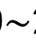20000 Hz，
受基底膜谐振频率范围的制约。

[查看课件图示 · p.48](../decks/ch1.pdf#page=48)

## c1-b16 · 响度（基本概念）

第1章 · PDF p.52

PDF p.52
响度（基本概念）

痛阈

◼响度（Loudness）

□响度：反映一个人主观

感觉不同频率成分的声
音强弱的物理量，单位
为方（phon）。

□是一种主观心理量，主

观感觉到的声音强弱的
一种衡量标准，它与频
率有关。一样的音强，
不一样的频率，则响度
也会有所不同。

等响度曲线

听阈：声音小到人耳刚刚能听见时的大小
痛阈：声音大到人耳刚刚感觉痛时的大小

[查看课件图示 · p.52](../decks/ch1.pdf#page=52)

## c1-b17 · 音调的主观（基本概念）

第1章 · PDF p.53

PDF p.53
音调的主观（基本概念）

◼音调

□听觉分辨声音高低时，用于描述这种感觉的一种特性

□声带振动的频率（即基音）决定了声音频率的高低，

频率快则音调高，否则音调低

□客观上用频率来表示音调，主观上感觉音调的单位时

梅尔（Mel）尺度。梅尔频率与客观音频率f 的转换关
系为：

f
f

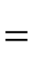 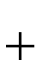 )
700
1(
log
2595
)
Mel(
10

## c1-b18 · 语音中语言、副语言和非语言信息的感知（基本概念）

第1章 · PDF p.54

PDF p.54
语音中语言、副语言和非语言信息的感知（基本概念）

语音转写

语音识别

文语转换（TTS）

语音合成

Linguistic
语言信息

Speech
言语 副语言信息
Prosody

情感识别

非语言信息
Personal
information 说话人识别
说话人辨认

## c1-m01 · 言语链

第1章 · PDF p.57、58、59

PDF p.57
言语链

◼生成感知认知回路和言语交互理解回路在同一知识语境和语言语境下工作。

◼反映了说话人的意图如何以言语的形式编码并传递给听话人。

◼反映了如何在听话人的大脑中解码、再现说话人的意图。

[查看课件图示 · p.57](../decks/ch1.pdf#page=57)

PDF p.58
言语链

言语（语音）产生：

◼基于意图来决定说话的内容-》言语中枢进行言语规划（将抽象的概念

映射到词汇表征，并以正确的顺序给出词汇的音素、语调和时长。）

◼大脑的言语运动中心编排对应的发音运动程序，并传递到后续神经系

统，按照时序来执行。下一级神经水平运动指令又将动作信息传递给
负责语音产生的所有肌肉。

◼由于肌肉收缩，肺部提供的空气流穿过声带，产生不同类型的声源，

并经过口腔和鼻腔的调制，由唇部、鼻孔的声波放射以及声道壁振动
辐射，产生语音信号。

[查看课件图示 · p.58](../decks/ch1.pdf#page=58)

PDF p.59
言语链

言语链反向运作

言语（语音）感知：

◼机械振动-》流体的行波-》神经脉冲，经由听觉神经传递给脑干、丘

脑和听觉皮层。大脑的语言中枢通过整合语义、语调、时长和能量包
络等信息识别传达意义的音素。

◼通过音质等额外信息辨识说话者、了解说话者的健康、情绪状态。

◼听话人的大脑高级中枢会有意识或潜意识地将这些输入的声学特征和

语言信息与以前的记忆和当前的语境相结合，解读说话人的思维，“
再现”说话人意图的某种程度的“复制品”。

[查看课件图示 · p.59](../decks/ch1.pdf#page=59)

## c1-p01 · 言语链与人机语音交互（重点掌握）

第1章 · PDF p.60

PDF p.60
言语链与人机语音交互（重点掌握）

语音产生 自然语言处理
ASR: 语音识别（对应人的语音感知）
TTS: 语音合成（对应人的语音生成）
Speaker Recognition: 说话人识别/声纹识别

言语认知与交互

[查看课件图示 · p.60](../decks/ch1.pdf#page=60)

## c2-b01 · 奈奎斯特频率（基本概念）

第2章 · PDF p.9

PDF p.9
奈奎斯特频率（基本概念）

◼奈奎斯特频率：离散信号系统采样频率的一半。

◼奈奎斯特–香农采样定理：对于一个给定的采样频率

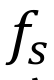，完全重构的频带限制为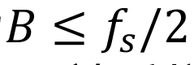 。也就是说，只要
离散系统的奈奎斯特频率高于被采样信号的最高频率或
带宽，就可以避免混叠现象。

◼奈奎斯特–香农采样定理的名字是为了纪念哈里·奈奎

斯特和克劳德·香侬。

常用的采样频率：8k Hz, 16k Hz, 44.1k Hz

哪种音频信号的采样频率为44.1k Hz？
为什么采用44.1k Hz？ CD

人的听觉范围: 20-20000 Hz

## c2-b02 · 语音信号预处理-分帧(Framing)（基本概念）

第2章 · PDF p.13、43

PDF p.13
语音信号预处理-分帧(Framing)（基本概念）

帧长

非周期的语音信号
准周期信号
13

[查看课件图示 · p.13](../decks/ch2.pdf#page=13)

PDF p.43
语音产生的声源-滤波器模型

•
发音器官连续运动形成时变的声道形状，由声源驱动产生语音信号。

•
发音器官的运动频率大约在50 Hz以下，所以可以近似地认为声道形状在20 ms
的范围内是稳定不变的。

•
因此，语音生成系统在20-30 ms的区间内可以用下面的线性时不变系统近似。

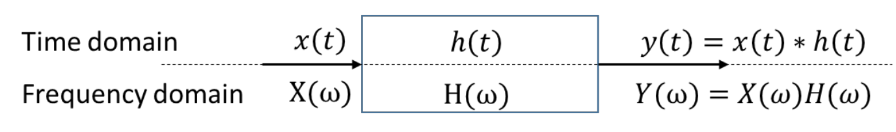

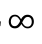

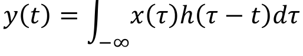

[查看课件图示 · p.43](../decks/ch2.pdf#page=43)

## c2-b03 · 语音信号预处理-加窗(Windowing)（基本概念）

第2章 · PDF p.14、15

PDF p.14
语音信号预处理-加窗(Windowing)（基本概念）

目的：为了使时域信号更好地满足离散傅里叶变换的周
期性要求，减少泄漏。

加窗后的语音信号：

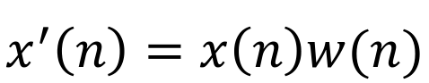

PDF p.15
语音信号预处理-加窗(续)（基本概念）

◼汉明窗（Hamming window）：

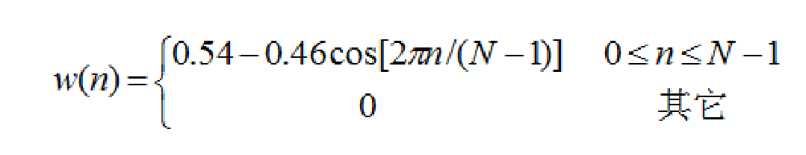

◼汉宁窗（Hanning window）：

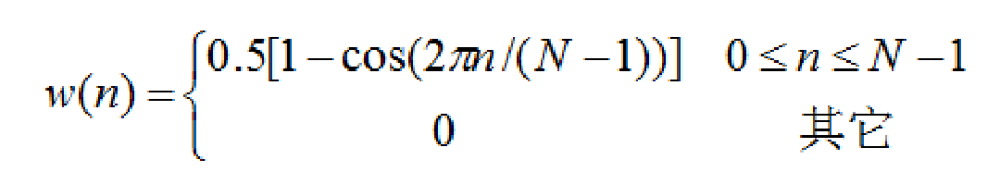

◼矩形窗（Rectangular window）：

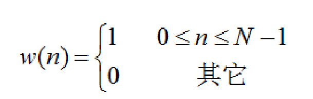

[查看课件图示 · p.15](../decks/ch2.pdf#page=15)

## c2-b04 · 时域信号处理方法-短时能量

第2章 · PDF p.18、19、21

PDF p.18
时域信号处理方法-短时能量

◼短时能量（short-time energy）

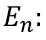 信号的第n个点开始加窗函数的短时能量

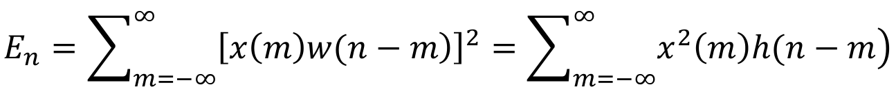

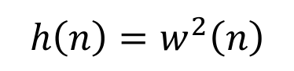 其中， 是窗函数

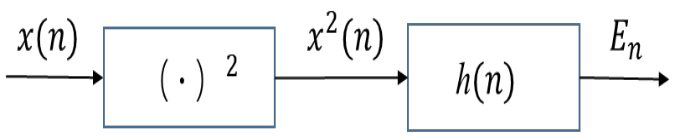

短时平均能量的计算

PDF p.19
时域信号处理方法-短时能量（续）

不同宽度矩形窗的短时能量函数

应用：浊音和清音的区分、语音端点检测（有声段和无声段的判定）、

声母与韵母的分界、特征分析（语音情感分类的一种特征）等
19

[查看课件图示 · p.19](../decks/ch2.pdf#page=19)

PDF p.21
时域信号处理方法-短时间平均过零率（续）

ZCR反映了包括主能量在内的区域的平均频率：
• 浊音: 大约1400 Hz
• 清音: 大约4500 Hz

应用：浊音和清音的区分、语音端点检测（短时平均能量和ZCR的结合）等

[查看课件图示 · p.21](../decks/ch2.pdf#page=21)

## c2-b05 · 时域信号处理方法-短时间平均过零率

第2章 · PDF p.20、21

PDF p.20
时域信号处理方法-短时间平均过零率

◼短时间平均过零率 （zero-cross rate：ZCR)：

信号采样点符号变化的次数

其频率表征可由下式计算

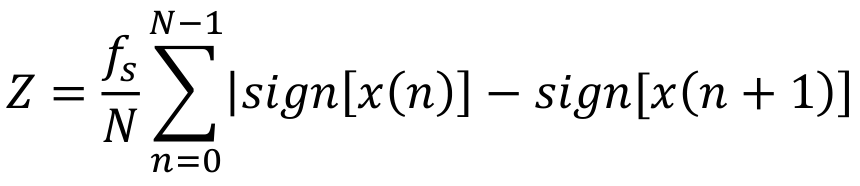

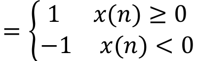

其中，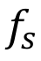为采样频率，N为窗的点数，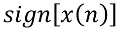

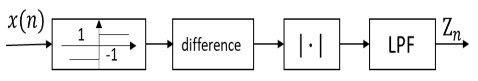

短时平均过零率的计算

PDF p.21
时域信号处理方法-短时间平均过零率（续）

ZCR反映了包括主能量在内的区域的平均频率：
• 浊音: 大约1400 Hz
• 清音: 大约4500 Hz

应用：浊音和清音的区分、语音端点检测（短时平均能量和ZCR的结合）等

[查看课件图示 · p.21](../decks/ch2.pdf#page=21)

## c2-b06 · 时域信号处理方法-短时自相关函数

第2章 · PDF p.22、23

PDF p.22
时域信号处理方法-短时自相关函数

◼自相关函数（Autocorrelation）：

自相关函数是测定相同信号在时域内的相似度

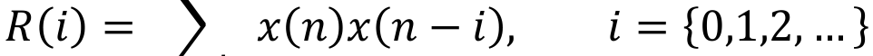

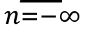

◼短时自相关函数（Short-time autocorrelation）：

在自相关函数的基础上加短时分析

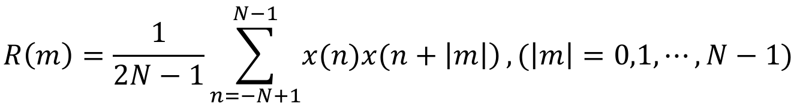

主要用于研究信号本身的同步性，周期性

PDF p.23
时域信号处理方法-短时自相关函数（续）

◼性质

• 对称性

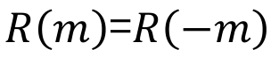

•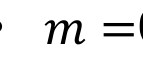0时达最大值

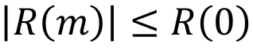

• 白噪音的自相关
连续时间白噪声信号的自相关在
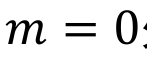处有一个强峰值，而在所
有其他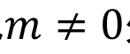处值为0。

应用：浊音和清音的区分、浊音周期估计等

短时自相关函数为什么可以应用到以上任务？

如果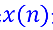是一个周期信号，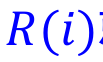就会在等于周期整数倍的点取极大值。

## c2-b07 · 为什么需要频域分析？

第2章 · PDF p.25、43

PDF p.25
为什么需要频域分析？

◼人类听觉系统具有频谱分析功能

◼频域的计算更简便：时域的卷积相当于频谱的乘积

语音信号的频谱分析，是认识和处理语音信号的重要方法

[查看课件图示 · p.25](../decks/ch2.pdf#page=25)

PDF p.43
语音产生的声源-滤波器模型

•
发音器官连续运动形成时变的声道形状，由声源驱动产生语音信号。

•
发音器官的运动频率大约在50 Hz以下，所以可以近似地认为声道形状在20 ms
的范围内是稳定不变的。

•
因此，语音生成系统在20-30 ms的区间内可以用下面的线性时不变系统近似。

[查看课件图示 · p.43](../decks/ch2.pdf#page=43)

## c2-b08 · 离散傅里叶变换

第2章 · PDF p.29、30、31、32、33、34、35、36

PDF p.29
离散傅里叶变换

离散傅里叶变换（Discrete Fourier Transform）

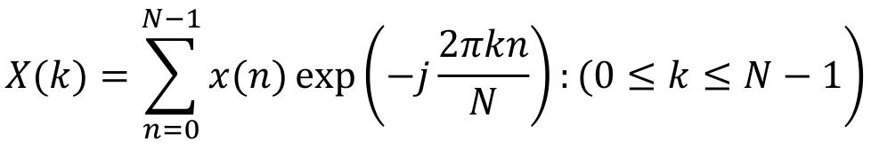

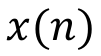：时间窗内采样的离散语音信号

离散傅里叶逆变换（Inverse Discrete Fourier Transform）

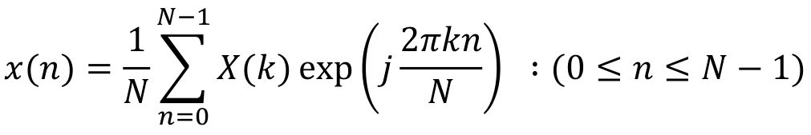

X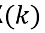：语音信号的离散频谱（复数序列）

PDF p.30
从语音信号到频谱向量的序列

FFT
FFT FFT

频谱

[查看课件图示 · p.30](../decks/ch2.pdf#page=30)

PDF p.31
从语音信号到频谱向量的序列

FFT FFT
FFT
FFT
FFT
FFT
FFT
FFT
FFT
FFT
FFT
FFT  FFT
FFT

频谱

31

[查看课件图示 · p.31](../decks/ch2.pdf#page=31)

PDF p.32
从语音信号到频谱向量的序列

FFT FFT
FFT
FFT
FFT
FFT
FFT
FFT
FFT
FFT
FFT
FFT  FFT
FFT

频谱

Amp.

Hz
32

[查看课件图示 · p.32](../decks/ch2.pdf#page=32)

PDF p.33
从语音信号到频谱向量的序列

FFT
FFT
FFT FFT
FFT
FFT
FFT
FFT
FFT
FFT
FFT
FFT  FFT
FFT

频谱

旋转90度
Hz

33
Amplitude

[查看课件图示 · p.33](../decks/ch2.pdf#page=33)

PDF p.34
从语音信号到频谱向量的序列

FFT FFT
FFT
FFT
FFT
FFT
FFT
FFT
FFT
FFT
FFT
FFT  FFT
FFT

频谱

Hz
•能量越高对应的颜色越深

34
Amplitude

[查看课件图示 · p.34](../decks/ch2.pdf#page=34)

PDF p.35
从语音信号到频谱向量的序列

FFT FFT
FFT
FFT
FFT
FFT
FFT
FFT
FFT
FFT
FFT
FFT  FFT
FFT

频谱

Hz

Time

35

[查看课件图示 · p.35](../decks/ch2.pdf#page=35)

PDF p.36
语谱图

FFT
FFT
FFT
FFT
FFT
FFT
FFT
FFT
FFT
FFT
FFT
FFT  FFT
FFT

语谱图：语音信号的时频表征

Hz

Time

[查看课件图示 · p.36](../decks/ch2.pdf#page=36)

## c2-b09 · 语谱图

第2章 · PDF p.30、31、32、33、34、35、36

PDF p.36
语谱图

FFT
FFT
FFT
FFT
FFT
FFT
FFT
FFT
FFT
FFT
FFT
FFT  FFT
FFT

语谱图：语音信号的时频表征

Hz

Time

[查看课件图示 · p.36](../decks/ch2.pdf#page=36)

PDF p.30
从语音信号到频谱向量的序列

FFT
FFT FFT

频谱

[查看课件图示 · p.30](../decks/ch2.pdf#page=30)

PDF p.31
从语音信号到频谱向量的序列

FFT FFT
FFT
FFT
FFT
FFT
FFT
FFT
FFT
FFT
FFT
FFT  FFT
FFT

频谱

31

[查看课件图示 · p.31](../decks/ch2.pdf#page=31)

PDF p.32
从语音信号到频谱向量的序列

FFT FFT
FFT
FFT
FFT
FFT
FFT
FFT
FFT
FFT
FFT
FFT  FFT
FFT

频谱

Amp.

Hz
32

[查看课件图示 · p.32](../decks/ch2.pdf#page=32)

PDF p.33
从语音信号到频谱向量的序列

FFT
FFT
FFT FFT
FFT
FFT
FFT
FFT
FFT
FFT
FFT
FFT  FFT
FFT

频谱

旋转90度
Hz

33
Amplitude

[查看课件图示 · p.33](../decks/ch2.pdf#page=33)

PDF p.34
从语音信号到频谱向量的序列

FFT FFT
FFT
FFT
FFT
FFT
FFT
FFT
FFT
FFT
FFT
FFT  FFT
FFT

频谱

Hz
•能量越高对应的颜色越深

34
Amplitude

[查看课件图示 · p.34](../decks/ch2.pdf#page=34)

PDF p.35
从语音信号到频谱向量的序列

FFT FFT
FFT
FFT
FFT
FFT
FFT
FFT
FFT
FFT
FFT
FFT  FFT
FFT

频谱

Hz

Time

35

[查看课件图示 · p.35](../decks/ch2.pdf#page=35)

## c2-b10 · 宽带语谱图与窄带语谱图

第2章 · PDF p.38

PDF p.38
宽带语谱图与窄带语谱图

宽带滤波器(200 Hz，窗长5 ms)
—更低的频率分辨率
—更高的时间分辨率（周期性清晰）
观测共振峰(F1, F2，…)

窄带滤波器(25 Hz，窗长40 ms)
—更高的频率分辨率
—更低的时间分辨率（周期性被抹杀）
观测谐波(H1, H2，…)

(b) 宽带vs. (c)窄带语谱图

宽带：垂直条纹（垂直条纹的间隔时间为基音周期）
窄带：水平条纹（可以看见元音的共振峰频率及其随时间的变化），基音频率

[查看课件图示 · p.38](../decks/ch2.pdf#page=38)

## c2-b11 · 语音信号产生系统的线性模型

第2章 · PDF p.40、41、42

PDF p.40
语音信号产生系统的线性模型

◼激励模型

◼声道模型

◼辐射模型

[查看课件图示 · p.40](../decks/ch2.pdf#page=40)

PDF p.41
激励模型

◼激励模型非常复杂

◼声门脉冲模型

□浊音

◼声带振动，声门脉冲

◼如：斜三角形脉冲串

◼随机白噪声

□清音

◼声带不振动，随机白噪声

PDF p.42
语音生成的声学理论

语音生成的声学理论(Mueller, Chiba-Kajiyama, Fant)

◼声带的振动产生了元音的声源。准周期脉冲通过声道，声道相当于滤波器，

抑制某些频率，增强另外一些频率。其结果形成我们可以辨识的元音特征。

◼辅音声源处在声道中的不同位置，将声道分为前后腔。因此，声道需要两个

以上的滤波器建模。

[查看课件图示 · p.42](../decks/ch2.pdf#page=42)

## c2-b12 · 语音生成的声学理论

第2章 · PDF p.42、43

PDF p.42
语音生成的声学理论

语音生成的声学理论(Mueller, Chiba-Kajiyama, Fant)

◼声带的振动产生了元音的声源。准周期脉冲通过声道，声道相当于滤波器，

抑制某些频率，增强另外一些频率。其结果形成我们可以辨识的元音特征。

◼辅音声源处在声道中的不同位置，将声道分为前后腔。因此，声道需要两个

以上的滤波器建模。

[查看课件图示 · p.42](../decks/ch2.pdf#page=42)

PDF p.43
语音产生的声源-滤波器模型

•
发音器官连续运动形成时变的声道形状，由声源驱动产生语音信号。

•
发音器官的运动频率大约在50 Hz以下，所以可以近似地认为声道形状在20 ms
的范围内是稳定不变的。

•
因此，语音生成系统在20-30 ms的区间内可以用下面的线性时不变系统近似。

[查看课件图示 · p.43](../decks/ch2.pdf#page=43)

## c2-b13 · 听觉滤波机理与建模（基本概念）

第2章 · PDF p.46

PDF p.46
听觉滤波机理与建模（基本概念）

• 听觉滤波器（带通滤波器）：实现听觉末梢系统中的声学
频率分析。

• 等效矩形带宽(ERB)：根据心理物理实验结果获得的滤波
器的带宽。

•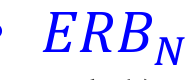：听力正常人的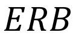。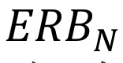传递的能量与其对应的
听觉滤波器相同，并显示它如何随着输入频率改变。

  其中，F 是以Hz为单位的中心频率。

## c2-b14 · 双耳声源定位及麦克风阵列（基本概念）

第2章 · PDF p.49

PDF p.49
双耳声源定位及麦克风阵列（基本概念）

◼声音定位是听者在方向和距离上识别探测到的声音的位置或来源的能力，这是

为了防御敌人的本能之一。

◼两耳时间差 (Interaural Time Difference：ITD)：比如，来自右侧的声音到

达右耳的时间比到达左耳的时间要早。它适用于低频<800Hz。

◼两耳声强差 （Interaural Intensity Difference：IID) ：比如，来自右边

的声音在右耳比在左耳有更高的强度水平，因为头部遮挡了左耳。这些声强差
异与频率密切相关，并且随着频率的增加而增加。它适用于高频>1600Hz。

[查看课件图示 · p.49](../decks/ch2.pdf#page=49)

## c2-b15 · 双耳声源定位及麦克风阵列（基本概念）

第2章 · PDF p.49

PDF p.49
双耳声源定位及麦克风阵列（基本概念）

◼声音定位是听者在方向和距离上识别探测到的声音的位置或来源的能力，这是

为了防御敌人的本能之一。

◼两耳时间差 (Interaural Time Difference：ITD)：比如，来自右侧的声音到

达右耳的时间比到达左耳的时间要早。它适用于低频<800Hz。

◼两耳声强差 （Interaural Intensity Difference：IID) ：比如，来自右边

的声音在右耳比在左耳有更高的强度水平，因为头部遮挡了左耳。这些声强差
异与频率密切相关，并且随着频率的增加而增加。它适用于高频>1600Hz。

[查看课件图示 · p.49](../decks/ch2.pdf#page=49)

## c2-b16 · 双耳声源定位及麦克风阵列（基本概念）

第2章 · PDF p.49

PDF p.49
双耳声源定位及麦克风阵列（基本概念）

◼声音定位是听者在方向和距离上识别探测到的声音的位置或来源的能力，这是

为了防御敌人的本能之一。

◼两耳时间差 (Interaural Time Difference：ITD)：比如，来自右侧的声音到

达右耳的时间比到达左耳的时间要早。它适用于低频<800Hz。

◼两耳声强差 （Interaural Intensity Difference：IID) ：比如，来自右边

的声音在右耳比在左耳有更高的强度水平，因为头部遮挡了左耳。这些声强差
异与频率密切相关，并且随着频率的增加而增加。它适用于高频>1600Hz。

[查看课件图示 · p.49](../decks/ch2.pdf#page=49)

## c2-m01 · 倒谱（Cepstrum）的定义

第2章 · PDF p.51、52、53、54、55

PDF p.52
倒谱（Cepstrum）的定义

◼倒谱：信号的傅里叶变换经对数运算后再进行傅里叶

反变换得到的谱。在语音信号处理中一般对频谱进行
取幅度值运算。

[查看课件图示 · p.52](../decks/ch2.pdf#page=52)

PDF p.51
语音频谱与语音包络分析

频谱

频谱
包络

频谱
细节

[查看课件图示 · p.51](../decks/ch2.pdf#page=51)

PDF p.53
基于语音生成的方法-倒频谱分析

语音信号序列是声源和声道脉冲的卷积：

在频域上，语音信号的功率谱可以被描述为声源频谱和
声道频谱的乘积

将上述公式取对数，（假设与 无关）我们可以得到

PDF p.54
基于语音生成的方法-倒频谱分析

• 在IFFT之后，结果被转移到一个所谓的“类频率”
（quefrency）空间而非时域空间。被称为“倒
频谱”（cepstrum）

• 由于声源频谱的频率比声道频谱的频率高
得多，

•（）对应声源信息。
•（）对应系统信息。

• 可以用一个“Lifter” 窗函数提取想要的信息，

PDF p.55
基于FFT的倒频谱分析

‘倒频谱’←‘频谱’

‘cepstrum’  ←  ‘spectrum’

Oppenheim, A. V.  & Shafer, R. W. (2004) From frequency to quefrency: A history of the
cepstrum. IEEE Signal Processing Magazine, 21: 95-106.

[查看课件图示 · p.55](../decks/ch2.pdf#page=55)

## c2-m02 · 线性预测编码（LPC）

第2章 · PDF p.57、58

PDF p.58
线性预测编码（LPC）

线性预测编码 （Linear predictive coding：LPC) 是通过已知个采样 

  的线性组合推测信号的当前值  ，

 是观测值和预测值的残差， 是加权系数。

[查看课件图示 · p.58](../decks/ch2.pdf#page=58)

PDF p.57
线性预测的基本思路

 

语音信号产生的模型化

◼可以将语音看作是由输入序列（声源）激励一个全极点的系

统而产生的输出。

◼自回归（auto-regressive）模型（简称

AR模型）的传递函数为：

为常数；为实数；为模型的阶数。

◼用系数可以定义一个阶线性预测器。

## c2-m03 · 梅尔频率倒谱系数(MFCC)--- FFT

第2章 · PDF p.65、66、67、68、69、70

PDF p.66
梅尔频率倒谱系数(MFCC)--- FFT

①

②

③

④
⑤

①语音信号经过预加重、加窗、分帧的预处理过程，得到帧序列

语音信号。
②对帧序列语音信号进行离散傅里叶变换（DFT），取模的平方

得到离散能量谱 

PDF p.65
梅尔尺度（Mel-scale）

• 人耳对不同频率的灵敏度响应是不同的，即以赫兹为

单位时，人耳的听觉系统是一个非线性的系统，整体

成对数曲线趋势。

• 梅尔频率的产生很好地模拟了人耳的感知特性曲线。

梅尔频率与客观音频率f 的转换关系为：

f
f

  )
700
1(
log
2595
)
Mel(
10

PDF p.67
梅尔频率倒谱系数(MFCC)--- 梅尔滤波器组

[查看课件图示 · p.67](../decks/ch2.pdf#page=67)

PDF p.68
梅尔频率倒谱系数(MFCC)--- 梅尔滤波器组（续）

[查看课件图示 · p.68](../decks/ch2.pdf#page=68)

PDF p.69
梅尔频率倒谱系数(MFCC)--- DCT

①

②

③

④
⑤

PDF p.70
MFCC的计算流程图及MFCC系数的物理意义

• C0：语音的平均强度，在语音识别中一般不直接使用。
• 随着阶数增加，MFCC表示频谱的更多细节。但是无论是MFCC
还是LPC系数都不能直接展示共振峰的频谱包络的细节信息。

## c3-b01 · 什么是语音识别（ASR）？

第3章 · PDF p.5、6、7

PDF p.5
什么是语音识别（ASR）？

◼定义：

□自动语音识别（Automatic Speech Recognition）：机器通

过识别把人类的语音信号转变为相应的文本的技术。

□语音信息处理的最核心方法

ASR
系统
“How are you?”

语音
文本

◼语音识别的结果作为

□最终输出（转写：Dictation）

□自然语言处理（对话系统、机器翻译）的输入

[查看课件图示 · p.5](../decks/ch3.pdf#page=5)

PDF p.6
语音识别的用途

◼语音识别的结果作为

□最终输出（转写：Dictation）

[查看课件图示 · p.6](../decks/ch3.pdf#page=6)

PDF p.7
语音识别的用途（续）

◼语音识别的结果作为

□最终输出（转写：Dictation）

□自然语言处理（对话系统、机器翻译）的输入

[查看课件图示 · p.7](../decks/ch3.pdf#page=7)

## c3-b02 · 语音识别的分类

第3章 · PDF p.8、9、10

PDF p.8
语音识别的分类

◼按发音方式分

□孤立词（isolated words）识别

“打开空调”

□连接词（connected words）识别

“现在 我 简单 介绍 语音 识别 的 基本 概念。”
连续数字识别

□连续语音（continuous speech）识别

“现在我简单介绍语音识别的基本概念。”

PDF p.9
语音识别的分类

◼按词汇表（Vocabulary）的大小分

□小词汇表识别系统

包括10~100个词条

□中词汇表识别系统

包括100~1000个词条

□大词汇表识别系统

包括1000个以上的词条

PDF p.10
语音识别的分类

◼按说话人分

□特定说话人（speaker-dependent）语音识别

只能识别固定某个人的语音

□非特定说话人（speaker-independent）语音识别
     能识别任意人的语音

## c3-b03 · 语音识别评价指标

第3章 · PDF p.11

PDF p.11
语音识别评价指标

◼单词错误率（Word Error Rate）

Insertion：插入；Substitution：置换；Deletion：删除

Alignment example:
REF:   portable ****     PHONE UPSTAIRS last night so
HYP:   portable FORM  OF       STORES    last night so
Eval                     I          S            S

单词错误率评价指标的缺点？
有没有其他更合适的评价指标？

WER = 100 (1+2+0)/6 = 50%

## c3-b04 · 语音识别主流方法的演化

第3章 · PDF p.13、14、15、16、17

PDF p.13
语音识别主流方法的演化

Before mid 70’s
Mid 70’s – mid 80’s
After mid 80’s

启发式
（Heuristic） 模板匹配
（Template matching） 统计模型
（Mathematical）

Rule-based and
declarative Deterministic and
data-driven Probabilistic and
data-driven

模式识别方法
（Pattern Recognition Approach）

PDF p.14
基于规则的语音识别

◼利用规则来指导语音识别:

□Phonetics（语音学）：研究语音的学科，重点关注语音物理/生

理（发音、声学、听觉）特性；

□Phonology（音韵学）：研究音位或语音区别特征在某种语言中

运作的抽象规则和语音的系统；

□Syntax（语法）：研究语言符号（词）组合成更大单位（短语

、句子）的结构规则，含词法与句法。

□Pragmatics（语用学）：研究语言在具体语境中的使用，研究字

面意思之外、依靠上下文 / 场景 / 交际双方背景推出的含义。

◼缺点

□难以表达规则

□难以知道如何提升系统的性能

PDF p.15
基于数据驱动的语音识别

Dynamic Timing Warping,
Hidden Markov Model
深度学习等

特征
(向量)
识别结果

特征提取
模式匹配
语音

LPC、MFCC等

Reference
word pattern,

Acoustic
model etc.

PDF p.16
基于模板匹配的语音识别

◼概念：将输入模板与参考模板比较，查找最相似的模板

Different length

↓
How to compare?
输入
模板

x1 x2 x3
…  xI How about linear
alignment?

X

 y1

Y1 3
…  y1 J1

参考
模板1

参考
模板N

yN 1 yN 2 yN

YN
16 3
…                      … yN JN

[查看课件图示 · p.16](../decks/ch3.pdf#page=16)

PDF p.17
基于模板匹配的语音识别（续）

◼如何计算两个矢量序列X和Y之间的相似度?

X={x1 , x2 , x3 , … ，xI }

Y={y1 , y2 , y3 , … ，yJ }

存在问题：

•
长度不同， 

•
对不准

◼经典解决方法：动态时间弯折/归正（DTW）
   把时间归正和距离测度计算结合起来的非线性归正技术。

DTW是采用动态规划（Dynamic Programming，DP）技术，将一个复
杂的全局问题转化为许多局部最优问题，逐步进行决策。
   将表示两个语音段的矢量序列对准了再计算相似度。

## c3-b05 · 动态时间归正的思路

第3章 · PDF p.17、18、19、20、21、22、23、24、25

PDF p.18
动态时间归正的思路

◼如何对准？

终点

参考模板时间轴i i=w(j)

10

5

开始

1

0  1        5         10        15         20

待测语音时间轴j

▷每一条从（1，1）到（I, J）路径都有一个累计距离称为路径的代价。
▷每一条路径都代表一种对齐情况。
▷代价最小的路径就是所求对准路径。

PDF p.17
基于模板匹配的语音识别（续）

◼如何计算两个矢量序列X和Y之间的相似度?

X={x1 , x2 , x3 , … ，xI }

Y={y1 , y2 , y3 , … ，yJ }

存在问题：

•
长度不同， 

•
对不准

◼经典解决方法：动态时间弯折/归正（DTW）
   把时间归正和距离测度计算结合起来的非线性归正技术。

DTW是采用动态规划（Dynamic Programming，DP）技术，将一个复
杂的全局问题转化为许多局部最优问题，逐步进行决策。
   将表示两个语音段的矢量序列对准了再计算相似度。

PDF p.19
动态时间归正的思路（续）

◼将对准问题，或者说将求两个语音段的相似度问题，转

化成了搜索代价最小的最优路径问题。

◼事实上，在搜索过程中，往往要进行路径的限制

压缩待测语音 )
,
(
j
i

 j )
,1

（1）起点/终点的限制
（2）连续性限制

( i  )1 j
i )1
,
(

受一步局部路径约束

◼再此限制条件下，可以将全局最优化问题转化为许多局

部最优化问题一步一步地来求解，这就动态规划
(Dynamic Programming，简称DP)的思想。

PDF p.20
动态时间归正的思路（续）

定义一个代价函数
表示从起始点(1,1)出发，
到达（i, j）点最小代价路径的累计距离。 

有： 

则： 

：与的距离

依次类推，、、
可由更低一层的代价函数计算得到。

PDF p.21
动态时间归正的思路（续）

◼这样就可从

 逐步向上搜索。

▷加权系数的取值与局部路径有关

参考模板时间轴i 终点

i=w(j)

▷定义回溯函数 10

p(i,j)

5

▷平行四边形区域约束 1 开始

0  1        5         10        15         20

待测语音时间轴j

PDF p.22
动态时间归正路径搜索算法

（1）初始化：

 

参考模板时间轴i 终点

i=w(j)

约束区域Reg：可以假定是这样
一个平行四边形，它有两个顶
点位于(1,1)和(I,J)，相邻两
条边的斜率分别为2和1/2。 10

5

1 开始

0  1        5         10        15         20

待测语音时间轴j

PDF p.23
动态时间归正路径搜索算法（续）

 j )
,1 )
,
( j
i

(2)递推求累计距离，并记录回溯信息： ( i  )1 j
i  )1
,
(

受一步局部路径约束

一般取距离加权值为， ， 

并将(i,j)点的回溯信息记录在p(i,j)中。

PDF p.24
动态时间归正路径搜索算法（续）

（3）回溯求出所有的匹配点对：

根据每步的上一步最佳局部路径p(i,j)，由匹配点(I,J)对向
前回溯一直到(1,1)。这个回溯过程对于求平均模板或聚
类中心来讲是必不可少的，但在识别过程往往不必进行。

◼对所求得的 还需用 作为分母来归正

PDF p.25
动态时间归正算法缺点

◼很难区分非常类似的模板（硬匹配）

◼当输入和模板之间的声学条件不同时，语音识别的性能急剧

下降（缺少多样性）

◼没有充分利用语音信号的时序动态信息

◼无法利用语言模型（无法利用长上下文文本信息预测单词）

◼不利于进行大词汇表连续语音识别（LVCSR）

◼需要新的技术来消除以上问题

□更易于训练不同的模板

□更加鲁棒的匹配技术

□更适合于进行LVCSR

◼解决方案：基于统计模型的语音识别

## c3-p01 · 基于统计模型的语音识别框架（重点掌握）

第3章 · PDF p.26、92

PDF p.26
基于统计模型的语音识别框架（重点掌握）

语音增强+ 特征抽取 解码

Front-end processing Back-end processing

（前端处理） （后端处理）

什么是声学模型？
计算发音相似度的模型

[查看课件图示 · p.26](../decks/ch3.pdf#page=26)

PDF p.92
基于统计模型的语音识别框架（重点掌握）

语音增强+ 特征抽取 解码

Front-end processing Back-end processing

（前端处理） （后端处理）

[查看课件图示 · p.92](../decks/ch3.pdf#page=92)

## c3-b06 · 语音识别-噪音通道模型

第3章 · PDF p.27

PDF p.27
语音识别-噪音通道模型

◼噪音通道（Noisy Channel）模型

□源句子（source sentence）经过噪音通道（noisy channel）

会生成噪音句子（noisy sentence）。我们通过对噪音句
子的解码得到猜测的句子（guessed sentence）

□搜索所有可能的句子

□找出最优解

[查看课件图示 · p.27](../decks/ch3.pdf#page=27)

## c3-m01 · 语音识别-噪音通道模型（掌握）

第3章 · PDF p.28

PDF p.28
语音识别-噪音通道模型（掌握）

◼噪音通道（Noisy Channel）模型

□本质是求argmax P(W|X)：

给出声学特征X，查找最匹配的单词序列W。

□应用贝叶斯法则（Bayes’ rule）:

声学模型语言模型

因P(X)与W无关，可以去掉分母P(X)。

## c3-b07 · 语音识别-声学模型

第3章 · PDF p.29、30、31、32、33、34、35、36、101、102、104

PDF p.29
语音识别-声学模型

从GMM-HMM到端到端模型

2023-Now:
29 Speech Large Language Model

[查看课件图示 · p.29](../decks/ch3.pdf#page=29)

PDF p.30
语音识别-声学模型

◼GMM-HMM（高斯混合模型-隐马尔可夫模型）

观察值概率

观察值特征

•
L. R. Rabiner. A tutorial on hidden markov models and selected applications in
speech recognition. Proc. IEEE, 77(2):257–286, 1989.

[查看课件图示 · p.30](../decks/ch3.pdf#page=30)

PDF p.31
语音识别-声学模型

◼DNN-HMM（深度神经网络-隐马尔可夫模型）

状态转移概率

观察值概率

观察值特征

[查看课件图示 · p.31](../decks/ch3.pdf#page=31)

PDF p.32
语音识别-声学模型

◼End-to-end Model
（端到端模型）

不需要语言模型和词典

[查看课件图示 · p.32](../decks/ch3.pdf#page=32)

PDF p.33
语音识别-语言模型

◼语言模型：根据语言客观事实而进行的语言抽象数学建模，

用以计算文字序列的概率

◼分类

□基于文法的语言模型

□基于统计的语言模型（N-gram语言模型, 神经语言模型）

◼主要应用

□语音识别 ▷
例子：“（福建重口音）我要回福建省福州市，帮我
买盒五仁月饼。”，只有声学模型可能会被误识别为
“我要回胡建省湖州市，帮我买盒五人月饼。”

□文本生成

□机器翻译

□阅读理解

□… …
33

PDF p.34
语音识别-语言模型

◼N-gram（N元文法）语言模型

▷单词序列

 ...
1 w
w

n

▷概率的链式法则

 |
(
)...
|
(
)
|
(
)
(
)
( k  )
|
(

1
2
1
3
1
2
1
1 k
n
n
n
w
w
P
w
w
P
w
w
P
w
w
P
w
P
w
P 1

▷N-gram近似
假设词出现的概率只与前N-1个单词有关

k  )
|
(
)
(

1 k
n
w
w
P
w
P k

PDF p.35
语音识别-解码算法

 ：声学模型的似然

：语言模型的似然

 ：插入的惩罚

PDF p.36
语音识别-解码算法

◼Viterbi搜索算法

◼WFST（加权有限状态转换器）搜索算法

[查看课件图示 · p.36](../decks/ch3.pdf#page=36)

PDF p.101
语音识别-声学模型

从GMM-HMM到端到端模型

2023-Now:
101 Speech Large Language Model

[查看课件图示 · p.101](../decks/ch3.pdf#page=101)

PDF p.102
HMM的观测值概率分布

◼离散分布（Discrete Distribution）HMM

□矢量量化（Vector Quantization：VQ)

◼连续分布（Continues Distribution）HMM (CD-HMM)

□高斯混合模型（Gaussian Mixture Model：GMM)

□深度神经网络（Deep Neural Network：DNN)

PDF p.104
基于DNN的语音识别算法

◼20世纪80年代就开始进行结合ANN的尝试

□用ANN替换GMM

□用BP算法进行训练

◼但由于当时机器运算能力的限制及多层网络训练的复杂性，

其效果并不理想（过拟合）。

◼2010年，深度学习开始对语音识别领域产生重要的影响，其

识别错误率显著下降。

◼基于DNN的语音识别技术也是深度学习方法在工业界的第一

个成功应用，具有里程碑式的意义。

## c3-b19 · 语音识别-语言模型

第3章 · PDF p.33、34、118、119

PDF p.33
语音识别-语言模型

◼语言模型：根据语言客观事实而进行的语言抽象数学建模，

用以计算文字序列的概率

◼分类

□基于文法的语言模型

□基于统计的语言模型（N-gram语言模型, 神经语言模型）

◼主要应用

□语音识别 ▷
例子：“（福建重口音）我要回福建省福州市，帮我
买盒五仁月饼。”，只有声学模型可能会被误识别为
“我要回胡建省湖州市，帮我买盒五人月饼。”

□文本生成

□机器翻译

□阅读理解

□… …
33

PDF p.34
语音识别-语言模型

◼N-gram（N元文法）语言模型

▷单词序列

 ...
1 w
w

n

▷概率的链式法则

 |
(
)...
|
(
)
|
(
)
(
)
( k  )
|
(

1
2
1
3
1
2
1
1 k
n
n
n
w
w
P
w
w
P
w
w
P
w
w
P
w
P
w
P 1

▷N-gram近似
假设词出现的概率只与前N-1个单词有关

k  )
|
(
)
(

1 k
n
w
w
P
w
P k

PDF p.118
语言模型的定义

◼语言模型：用来计算一个句子概率的模型

▷从词表中任意选择若干同音词所构成的序列不一定能

构成自然语言中的合乎句法的句子。

▷人类在识别和理解语句时充分利用了这种约束。

◼在语音识别中的应用

▷在大词汇量的语音识别系统中，统计语言模型被广泛

应用来实现句子的约束。将这些知识与声学模型匹配
相结合进行结果判决，以减小由于声学模型不够合理
而产生的误识。

▷例子：“（福建重口音）我要回福建省福州市，帮我

买盒五仁月饼。”，只有声学模型可能会被误识别为
“我要回胡建省湖州市，帮我买盒五人月饼。”
118

PDF p.119
语言模型的分类

◼基于文法的语言模型

▷总结语法规则及语音规则

◼基于统计的语言模型

▷统计各个词的出现概率及其相互关联的条件概率

▷经典模型：N-gram语言模型

◼基于深度学习的语言模型（神经语言模型）

▷通过训练网络来学习词表征和单词序列的概率化表示

## c3-b08 · 马尔可夫链（基本概念）

第3章 · PDF p.45、46

PDF p.45
马尔可夫链（基本概念）

◼马尔可夫链：一种离散状态的马尔可夫过程（序列），为

状态空间中经过从一个状态到另一个状态的转换的随机过

程。具有如下性质：

□状态空间是有限的或可列；

□是一种离散时间随机过程；

□具有马尔可夫性质（无后效性）。即在给定当前知识或信息

的情况下，过去（即当期以前的历史状态）对于预测将来（

即当期以后的未来状态）是无关的。

PDF p.46
马尔可夫链的定义（基本概念）

定义  设随机过程的状态空间为： 

系统在时间t的状态只与其在时间t-1的状态相关，满足以下

关系

则称该随机过程为离散时间、离散状态的一阶马尔可夫过

程，或简称为一阶马尔可夫链。

## c3-b09 · 马尔可夫链的问题与隐马尔可夫模型（HMM）（基本概念）

第3章 · PDF p.49、50、58、59、76

PDF p.49
马尔可夫链的问题与隐马尔可夫模型（HMM）（基本概念）

◼实际问题比Markov链模型所描述的更为复杂。观察到的事件并

不是与状态一一对应，而是通过一组概率分布相联系。

◼HMM的定义：使用双重随机过程来描述模型，一个是Markov链，

描述状态的转移（不可见）；另一个随机过程描述状态和观察

值之间的统计对应关系（可见）。由于状态是不可见的，因此

称之为“隐” Markov模型（HMM）。

◼HMM创建于20世纪70年代，是美国数学家鲍姆(Leonard E. Baum)

等人提出来的。

◼每个状态上有观察值概率分布。
49

PDF p.50
HMM的示意图（基本概念）

用一个观测的概率分布与每一个状态对应，而不是一个确
定的观测值或事件，这就在马尔可夫序列的状态中引入了
随机性，使其状态并不能被直接观测。

[查看课件图示 · p.50](../decks/ch3.pdf#page=50)

PDF p.58
HMM的模型描述和参数（基本概念）

HMM可以用下列参数来描述，包括状态集合、观察值序列
和3个概率矩阵：

1）状态集合：
N:可能的状态数目。这些状态之间满足马尔可夫性质，是
马尔可夫模型中实际所隐含的状态。这些状态不可被直接观
测而得到。

2）可观测值集合：V
K：每个状态对应的可能的观察值数目。在模型中与隐含
状态相关联，可通过直接观测而得到。时刻t观察到的观察

PDF p.59
HMM的模型描述和参数（续）（基本概念）

3）初始状态概率矩阵： =[]
表示隐含状态在初始时刻t=1的概率矩阵。其中

4）状态转移矩阵：
描述了HMM中各个状态之间的转移概率，表示在t-1时刻状
态为即，且在t时刻状态为即的概率。

5）观测值概率矩阵：
表示在t时刻、隐含状态是的条件下，观察值为的概率。

一个HMM的参数组为：；简写为：

PDF p.76
语音识别领域离散HMM的典型结构（基本概念）

a11=0.6
a22=0.2

S0
S3 S1
S3
S2
S0

a12=0.4
a23=0.8
a01=1.0

b1(v1) = 0.7
b1(v2) = 0.3 b2(v1) = 0.6
b2(v2) = 0.4 离散随机变量
的概率分布
（Discrete
Distribution）

从左向右HMM
（Left-to-right HMM）

## c3-b10 · HMM的三个基本问题（基本概念）

第3章 · PDF p.60

PDF p.60
HMM的三个基本问题（基本概念）

问题1：模型概率计算问题

已知一个HMM参数组，和给定一个观察值序列
的条件下，如何计算在给定模型的条件下
观察值序列的概率。

问题2：模型解码问题

给定模型和观察值序列，如何确定一个最佳状态序列

问题3：模型参数估计问题

给定观察值序列集合，如何调整参数，使得达到
最大值。

## c3-m02 · 模型概率计算 --- 前向算法(forward algorithm)（掌握）

第3章 · PDF p.63、64、65

PDF p.63
模型概率计算 --- 前向算法(forward algorithm)（掌握）

前向变量： 

定义：到时刻t为止部分观测序列为 ，且状态为
（为方便表示，在后面的算法中状态简记为i）的概率。

前向概率计算示意图
63

[查看课件图示 · p.63](../decks/ch3.pdf#page=63)

PDF p.64
模型概率计算 --- 前向算法（续）（掌握）

前向变量有如下性质：

（1）初值易求 

（2）可以计算 

前向概率计算示意图

（3）有递推关系 

因此可以利用递推关系，逐层递推，计算出全部。
最后再由计算得到。

[查看课件图示 · p.64](../decks/ch3.pdf#page=64)

PDF p.65
模型概率计算 --- 前向算法（续）（掌握）

前向算法：

（1）初始化：对 有

前向概率计算示意图

（2）递推:对 有

计算量？

 

 当N=5,T=100时，
只需2500次乘法运算

（3）终止： 

[查看课件图示 · p.65](../decks/ch3.pdf#page=65)

## c3-m03 · 模型概率计算---后向算法(backward algorithm)（掌握）

第3章 · PDF p.66、67

PDF p.66
模型概率计算---后向算法(backward algorithm)（掌握）

后向变量： 

定义：从时刻t+1开始到T 为止部分观测序列为
 ，且状态为的概率。

后向概率计算示意图
66

[查看课件图示 · p.66](../decks/ch3.pdf#page=66)

PDF p.67
模型概率计算 --- 后向算法（续）（掌握）

后向算法：

（1）初始化：对 有

后向概率计算示意图

（2）递推:对 有

计算量为数量级

（3）终止： 

[查看课件图示 · p.67](../decks/ch3.pdf#page=67)

## c3-m04 · Viterbi算法（掌握）

第3章 · PDF p.68、69、70

PDF p.69
Viterbi算法（掌握）

求取最佳状态序列的过程为

（1）初始化：对 有

（2）递推:对 有

[查看课件图示 · p.69](../decks/ch3.pdf#page=69)

PDF p.68
模型解码问题的描述（掌握）

◼最佳状态序列的确定

确定一个最佳状态序列 

为最大。

刻t时沿着一条路径，且,产生的最
大概率。

如何求解最佳状态序列Q?

解决思路：Viterbi算法

PDF p.70
Viterbi算法（续） （掌握）

求取最佳状态序列的过程为

（3）终止：

（4）路径回溯，确定最佳状态序列：

最终得到最佳状态序列以及所对应的概率

[查看课件图示 · p.70](../decks/ch3.pdf#page=70)

## c3-b11 · 模型参数估计的思路（基本概念）

第3章 · PDF p.71、72

PDF p.71
模型参数估计的思路（基本概念）

给定一个观察值序列确定一个
使得最大。实际上，不存在一种方法直接估计最佳的。 

思路：
  根据观察值序列选取初始模型，然后依据某
种方法求得一组新参数，保证有
。利用递归的思路重复这个过程，逐步改进模型参
数，直到收敛。

◼
经典的方法：Baum-Welch算法

PDF p.72
Baum-Welch算法（基本概念）

◼
Baum-Welch算法是用来解决当观测序列和隐状态序列未
知时的HMM参数的算法，该算法是期望最大化（EM）算
法的一个特例。

◼
设辅助函数。

▷
在步骤E(期望)求给定参数集上的；

▷
在步骤M(最大化)更新模型参数λ=(A,B,)。

◼
Baum-Welch算法未必能求得全局最大值、而有可能得到
一局部极值点。

## c3-b12 · 高斯混合模型（Gaussian Mixture Models)（基本概念）

第3章 · PDF p.80、81、82、83

PDF p.80
高斯混合模型（Gaussian Mixture Models)（基本概念）

◼高斯混合模型是用高斯概率密度函数精确地量化事物，将一个

事物分解为若干的基于高斯概率密度函数（正态分布曲线）形
成的模型。它可以看作是由M个单高斯模型组合而成的模型来
描述复杂的数据（比如语音数据）分布。

使用高斯混合模型是因为高斯分布具备很好的数学性质以及
良好的计算性能。

[查看课件图示 · p.80](../decks/ch3.pdf#page=80)

PDF p.81
高斯混合模型（续）（基本概念）

◼对于M个高斯模型的混合模型，是观测数据属于第m个子模型

的先验概率（混合权重），则高斯混合模型的概率分布为：

 ， 是第m个子模型的高斯分
布密度函数。

PDF p.82
高斯混合模型（续）（基本概念）

◼在语音处理中，我们通常用连续的概率密度函数来描述连续的

观察值向量（）的概率分布。混合高斯模型是其中应用最成
功的、最广泛的概率密度函数，若用混合高斯模型（GMM）来
表示的概率分布

其中，是状态i时第m个高斯子模型的权重，和为
状态i时第m个高斯分布的均值向量和协方差矩阵。

PDF p.83
基于GMM-HMM的语音识别框架（基本概念）

◼GMM-HMM（高斯混合模型-隐马尔可夫模型）

观察值概率

观察值特征

•

speech recognition. Proc. IEEE, 77(2):257–286, 1989.
83

[查看课件图示 · p.83](../decks/ch3.pdf#page=83)

## c3-b13 · 基于HMM的孤立词识别技术（基本概念）

第3章 · PDF p.84、137

PDF p.84
基于HMM的孤立词识别技术（基本概念）

◼孤立词识别原理图

词条1的

λ1 HMM

概率计算

词条2的

输入
语音x 特征提取
MFCC等 矢量
序列O λ2 HMM

 选择
决策

概率计算

词条V的

HMM

λV

概率计算

建模单元：孤立词或者子词（音素等）
84

PDF p.137
孤立词识别及解码技术（基本概念）

◼孤立词识别原理图

词条1的

λ1 HMM

概率计算

词条2的

输入
语音x 特征提取
MFCC等 矢量
序列O λ2 HMM

 选择
决策

概率计算

词条V的

HMM

λV

概率计算

## c3-b14 · 基于HMM的连续语音识别技术（基本概念）

第3章 · PDF p.86、87、91

PDF p.86
基于HMM的连续语音识别技术（基本概念）

◼连续语音识别（特别是大词表连续语音识别：LVCSR）

是语音识别研究中意义最重大、应用成果最丰富，同
时最具有挑战性的研究课题。

◼特有的问题：

□词（模式）的数量太多，语料不够；

□发音相近的内容多，误识严重;

□句子中的单词数不确定；

□单词边界（起始和结束时间）难以确定；

□发音变化（受协同发音的影响严重）。

PDF p.87
基于HMM的LVCSR系统的统一框架（基本概念）

◼将整个识别系统分为三层：声学—语音层、词层和句法层

□声学—语音层是识别系统的底层，它接受输入语音，并以一种

“子词（Subword）”单位作为其识别输出，每个子词单位对应一
套HMM结构和参数。

□词层规定词汇表中每个词是由什么音素—音子串接而成的。

□句法层中规定词按照什么规则组合成句子。

PDF p.91
基于HMM的LVCSR系统的统一框架（续）（基本概念）

语音输入                                                               识别的句子

特征提取
词级匹配
句子级匹配

                                  词模型                       语言模型

词模型的拼接

子词模型
词 典
语 法
语 义

基于子词单元的连续语音识别系统总体框图

## c3-b15 · 建模单元的选择 --- 原则（基本概念）

第3章 · PDF p.94、95、99

PDF p.94
建模单元的选择 --- 原则（基本概念）

◼以词作为基本单元建立模型不合理 ，造成大量不必要的

冗余存储和计算。因此一般采用比词小的子词识别基元，
如音节、半音节、音素等。

◼声学单元越小，其数量也就越少，训练模型的工作量也就

越小；

◼但是，单元越小，对上下文的敏感性越大，越容易受到前

后相邻的影响而产生变异，因此其类型设计和训练样本的
采集更困难。

PDF p.95
建模单元的选择 --- 三音素HMM（基本概念）

◼单音素建模没有考虑协同发音效应。协同发音

(coarticulation)是指在语流中，音段并非是静止的、分离
的声音，音段会对相邻的音段产生影响。

◼协同发音的一个解决方法是用三音素建模，考虑音素的上下

文，表示为“l-c+r”，其中，c表示中心单元，l为左相关信
息，r为右相关信息。

◼假设共有N个音素，那么就需要个三音素，当N增大时，参

数量也是非常大的。因此，在语音建模中，使用决策树来进
行三音素建模。这一过程依赖于单音素建模后的对齐。

PDF p.99
从单音素到三音素GMM（基本概念）

◼始于单音素, 进行EM训练

◼将高斯分布（Gaussians）

复制到三音素中

◼创建决策树并对高斯分布

进行聚类

◼复制并混合训练(GMMs)

[查看课件图示 · p.99](../decks/ch3.pdf#page=99)

## c3-b16 · 基于DNN的语音识别算法

第3章 · PDF p.104、106、107、108

PDF p.104
基于DNN的语音识别算法

◼20世纪80年代就开始进行结合ANN的尝试

□用ANN替换GMM

□用BP算法进行训练

◼但由于当时机器运算能力的限制及多层网络训练的复杂性，

其效果并不理想（过拟合）。

◼2010年，深度学习开始对语音识别领域产生重要的影响，其

识别错误率显著下降。

◼基于DNN的语音识别技术也是深度学习方法在工业界的第一

个成功应用，具有里程碑式的意义。

PDF p.106
深度神经网络（DNN）的介绍

◼深度神经网络（Deep Neural Network，DNN）可以简单的定义

为在输入层和输出层之间有多层隐含层（超过一层）的人工神
经网络。

◼经典的做法是先基于深度信念网络（Deep Belief Networks，

DBN）做预训练，之后用反向传播（Backpropagation，BP）算
法微调。

PDF p.107
深度神经网络(DNN)的介绍（续）

每一个神经元把经过乘法线性变换的上一层的输出求和得到
，然后通过非线性激活函数输出给下一层。对于包含L个隐
层的DNN，假设其输入为， 第层隐层的输出可以由
如下公式表示：

 Backpropagation

其中 是非线性激活函数，和
是第层隐层的权重和偏置向量。 

[查看课件图示 · p.107](../decks/ch3.pdf#page=107)

PDF p.108
深度神经网络(DNN)的介绍（续）

分类任务（比如：语音识别）的损失函数多采用最小交叉
熵（cross-entropy, CE）准则，可以表示如下：

其中是观测值属于第i类的经验概率分布（从训练数
据的标注中来），

是采用DNN估计的观测值属于第
i类的概率，表示为：

利用反向传播（）算法最小化得到更新网络的参数。

## c3-b17 · GMM-HMM（高斯混合模型-隐马尔可夫模型）回顾

第3章 · PDF p.102、109、110、111、112、113

PDF p.109
GMM-HMM（高斯混合模型-隐马尔可夫模型）回顾

观察值概率

观察值特征

•
L. R. Rabiner. A tutorial on hidden markov models and selected applications in
speech recognition. Proc. IEEE, 77(2):257–286, 1989.

[查看课件图示 · p.109](../decks/ch3.pdf#page=109)

PDF p.102
HMM的观测值概率分布

◼离散分布（Discrete Distribution）HMM

□矢量量化（Vector Quantization：VQ)

◼连续分布（Continues Distribution）HMM (CD-HMM)

□高斯混合模型（Gaussian Mixture Model：GMM)

□深度神经网络（Deep Neural Network：DNN)

PDF p.110
DNN-HMM语音识别算法框架

状态转移概率

◼用DNN替换GMM

◼用DNN计算观察值概率

◼用GMM-HMM算法分割

语音内容

◼在分割好的语音内容上

训练DNN

◼识别性能大幅度改善 观察值特征

[查看课件图示 · p.110](../decks/ch3.pdf#page=110)

PDF p.111
DNN-HMM的建模能力

◼DNN不需要对声学特征所服从的分布进行假设；

◼DNN的输入可以采用连续的拼接帧，更好的利用了上下文

信息；

◼DNN的训练过程可以采用随机优化算法来实现，因此当训

练数据规模较大时也能进行非常高效的训练；

◼在发音模式分类上，DNN这种鉴别式模型也要比GMM这种

生成式模型更加适合；

◼无监督预训练。

PDF p.112
DNN的输入

◼更底层的滤波器组（Filter Bank，FBK）声学特征。它

利用Mel滤波器组在功率谱上进行滤波并计算对数能量，
然后采用其规整值作为特征表示；

◼目前，FBK特征比MFCC有效；验证了原始语音频谱对基于

DNN的语音识别技术的重要性；

◼不同于传统的GMM采用单帧特征作为输入，DNN会进行拼

接帧的操作。会将相邻的若干帧进行拼接得到一个包含
更多信息的输入向量，例如每7帧构成一个输入。

PDF p.113
DNN的输出

◼DNN输出向量的维度对应HMM中状态的个数，通常每一维

输出对应一个绑定的triphone状态。

◼训练时，为了得到每一帧语音在DNN上的目标输出值（标

注值），需要通过事先训练好的GMM-HMM识别系统在训练
语料上进行强制对齐（Force alignment）。

◼基于GMM-HMM通过基于Viterbi算法的强制对齐方法，给

每个语音帧打上一个HMM状态标签，然后依据此状态标签
，基于DNN训练算法训练一个DNN模型。

◼用DNN替换GMM

## c3-b18 · DNN的训练

第3章 · PDF p.114、115、116

PDF p.114
DNN的训练

◼用BP算法直接进行训练往往效果不佳，这也是早期基于ANN

的混合声学模型未能成功应用的主要原因

◼多层神经网络参数优化是个高维非凸优化问题，常收敛较差

的局部解。

◼梯度消失问题：BP算法计算出的误差会从输出层开始向下呈

指数衰减，这样计算出各层的梯度也会随着深度的变化而显
著下降，导致靠近输出层的隐层训练的比较好，而靠近输入
层的隐层几乎不能得到有效训练。

◼解决方法：通过预训练找一个合适的初值。

PDF p.115
DNN的训练(续)

◼分为无监督的预训练(Pre-training)和有监督的鉴别性微

调(Fine-tuning)。

◼Pre-training

  用受限波尔兹曼机(Restricted Boltzmann Machines，
RBM)算法逐层训练构建深层置信网络(Deep Belief
Networks，DBN)。

◼Fine-tuning

  将DBN 作为DNN 的初始化参数,，采用标准误差反向传
播(Standard Error Back Propagation，BP)算法对DNN进
行调整。

PDF p.116
DNN的训练(续)

◼使用海量训练数据进行训练能有效避免过拟合问题；

◼Dropout等随机优化算法的提出也极大提高了DNN模型的

泛化能力；

◼一些措施的采用也成功地减小了梯度消失问题的影响

▷整流线性单元（Rectified Linear Units, ReLU）作为激活函数

▷采用卷积神经网（Convolutional Neural Networks, CNN）这种

深度网络结构。

## c3-b20 · 语言模型的评价指标（Perplexity）

第3章 · PDF p.120、124

PDF p.120
语言模型的评价指标（Perplexity）

◼衡量一个模型的拟合测试数据程度。

◼使用模型分配给测试集的概率。

◼估计测试语料库中的句子概率并取倒数，对句子长度进行

归一化。

 

◼测量预测下一个词时的加权平均分支因子(越低越好)

PDF p.124
N-gram语言模型的复杂度（困惑度）

◼模型训练了来自《华尔街日报》(WSJ)的3800万个单词

（可重复），词汇表的大小为19979个单词（互相不重
复的单词）

◼用《华尔街日报》150万单词进行评估

Unigram
Bigram
Trigram
Perplexity
962
170
109

124
没有使用语言模型（0-gram）时的perplexity为多少？

## c3-b21 · N-gram语言模型

第3章 · PDF p.122、123

PDF p.122
N-gram语言模型

◼单词序列

 ...
1 w
w

n

◼概率的链式法则

 |
(
)...
|
(
)
|
(
)
(
)
( k  )
|
(

1
2
1
3
1
2
1
1 k
n
n
n
w
w
P
w
w
P
w
w
P
w
w
P
w
P
w
P 1

◼N-gram近似

k  )
|
(
)
(

1 k
n
w
w
P
w
P k

122
假设词出现的概率只与前N-1个单词有关：N-1阶马尔可夫模型

PDF p.123
N-gram语言模型（续）

◼根据之前的上下文估计每个单词的概率

□P(phone | Please turn off your cell)

◼所需的参数数量随着先前上下文的单词数量呈指数增长

◼一个N-gram 模型只需要N1 个先前上下文的单词

□Unigram: P(phone)

□Bigram: P(phone | cell)

□Trigram: P(phone | your cell)

## c3-b22 · N-gram语言模型的概率估计

第3章 · PDF p.125、126

PDF p.125
N-gram语言模型的概率估计

◼基于单词序列的相对频率，可以从原始文本中估计出N-

gram条件概率。

w
w
C
w
w
P )
(

Bigram: |
(   n
n
n
n
w
C

)
(

n 

w
C
w
w
P  )
(

N-gram: |
(  n n

n
n C )
(

◼要有一个一致的概率模型，在每个句子中附加一个唯一

的开始<s>和结束</s>符号，并将它们视为附加单词。

PDF p.126
语言模型的平滑技术

◼由于存在可能的单词序列的组合数，许多罕见（但并非不

可能）的组合在训练中从未出现，因此最大似然估计（
MLE）错误地将许多参数（也就是稀疏数据）赋值为零。

◼如果在测试过程中出现了新的组合，则给出该组合的概率

为零，整个序列的概率为零。

◼在实际处理中，参数被平滑（又称正则化），以重新分配

一些概率值给未知的事件。

◼为未知的事件添加概率值需要将其从看到的事件中移除(折

现)，以保持和为1的联合分布。

## c3-b23 · 基于CTC的语音识别算法

第3章 · PDF p.146

PDF p.146
基于CTC的语音识别算法

◼什么是CTC？

▷Connectionist temporal classification，基于神经网络的连

接时序分类。

◼语音识别为什么需要CTC？

▷传统的语音识别的声学模型训练，对于每一帧的数据，

需要知道对应的标签(三音素)。
▷必须预先训练一个GMM-HMM声学模型。

▷采用GMM-HMM系统进行自动对齐标注。
▷对齐的准确性严重依赖GMM-HMM声学模型的可靠性。

▷不论是GMM-HMM声学模型训练，还是语音对齐过程，

都需要进行反复多次的迭代，非常耗时。

▷分阶段训练不合理。

## c3-b24 · 基于Attention的语音识别算法

第3章 · PDF p.148、149、150

PDF p.148
基于Attention的语音识别算法

◼另一个目前常用的序列到序列的模型是编码器-解码器模

型（Encoder-Decoder Model）

◼该模型由编码器和解码器两部分组成，其中编码器将输

入序列映射到一个指定长度的向量，解码器将指定长度
的向量解码为真实的标签。

◼2014年[1]提出将Attention机制加入到目前的编码器-解码

器模型（Encoder-Decoder）中，并成功应用到了机器翻
译中，同时取得了当时最好的效果。

[1] Bahdanau D, Cho K, Bengio Y. Neural machine translation by jointly learning to align and translate[J]. arXiv
preprint arXiv:1409.0473, 2014.

PDF p.149
基于Attention的语音识别算法

◼端到端语音识别的优点

▷直接将声学特征映射到更大的单元序列中，而不是音素

词

语音

字

▷字级输出对于下游自然语言处理（NLP）任务来说很容易

▷与传统的混合模型相比，Attention的模型实现了端到

端训练，能够将整个系统训练到最优。

▷与CTC相比，Attention不需要每帧独立的假设。

[查看课件图示 · p.149](../decks/ch3.pdf#page=149)

PDF p.150
基于Attention的语音识别算法

◼原始Attention模型的缺点

▷原始 LAS（Listen, Attend and Spell ）模型：自回归

Attention 没有强制时序对齐，容易对齐漂移，在噪声环境

下很难训练到很好的效果。

▷解决方案：CTC和Attention联合训练，采用CTC损失函数

针对下层Encoder做强制对齐。

▷其他方案（Transformer+Attention）：经过位置编码、掩码

、预训练。

## c3-b25 · 复杂声学场景下的语音识别（基本概念）

第3章 · PDF p.152、153

PDF p.152
复杂声学场景下的语音识别（基本概念）

◼当语音识别系统处于复杂声学场景下，由于训练声

学模型的声学场景与真实复杂声学场景差异过大，
导致语音识别系统性能大大降低。

◼而现实生活中，声学场景千变万化，训练集不能完

全覆盖所有声学场景

◼例如

▷训练时噪声、混响等环境可穷举、可模拟，现实中无法

穷举，导致训练集和测试集不匹配

PDF p.153
复杂声学场景下的语音识别（基本概念）

◼主要挑战

▷真实世界传感器需要获取声音，但是周围声音是各种各

样的，需要获取有效的人声
▷获取人声也不一定是目标任务的人声，可能是用户和别

人交谈的声音
▷在远场场景下获取的声音面临着回声干扰、室内混响、

多信号源干扰以及非平稳噪声的干扰等等

◼现状

▷研究新的声学信号处理技术或新的声学信号处理与语音

识别的联合优化方案

## c3-b26 · 多语言和跨语言语音识别（基本概念）

第3章 · PDF p.156

PDF p.156
多语言和跨语言语音识别（基本概念）

◼目前大多数语音识别系统都是针对一种语言的
◼对于每种语言都训练一个语音识别系统，所需要的

成本太高，且需要大量的数据
◼多语言语音识别和跨语言语音识别的区别在于

▷多语言语音识别只能识别训练集中出现过的语言

▷跨语言语音识别能识别出从未见过的语言。

◼例子

▷多语言语音识别：一个用英语、德语训练出来的模型，

可以同时对英语、德语进行语音识别

▷跨语言语音识别：一个用英语、德语训练出来的模型，

可以同时对英语、德语、法语进行语音识别

## c4-b01 · 什么是语音合成？

第4章 · PDF p.8、9

PDF p.8
什么是语音合成？

◼定义：

□语音合成（Speech Synthesis）：通过机械的、电子的方

法产生人造语音的技术。

□Text-to-Speech (TTS)：自动将文本转换为声音。

◼目标 还有哪些目标？

□Intelligibility（可懂度）

✓可懂度是指语音中有意义的语言单元（如单词、单句等）内容的可

识别（可被理解）的程度。（可以通过人工或ASR系统来测评）

□Naturalness（自然度）

✓自然度描述合成语音与人类语音听起来的接近程度。（尚未有唯一

的客观指标来评价）

我来自天津大学.  

[查看课件图示 · p.8](../decks/ch4.pdf#page=8)

PDF p.9
广义的语音合成

◼广义的语音合成研究内容包括：

▷语音转换(Voice Transformation/Conversion)
     说话人转换
      语音到歌唱转换(Speech to Singing)
      情感转换
      口音转换

▷歌唱合成(Singing Synthesis)
      文本到歌唱转换(Text/Lyric to Singing) 日本虚拟歌姬
使用了Yamaha的VOCALOID 2语音合成引擎

▷可视语音合成(Visual Speech Synthesis)

[查看课件图示 · p.9](../decks/ch4.pdf#page=9)

## c4-b02 · 什么是语音合成？

第4章 · PDF p.8

PDF p.8
什么是语音合成？

◼定义：

□语音合成（Speech Synthesis）：通过机械的、电子的方

法产生人造语音的技术。

□Text-to-Speech (TTS)：自动将文本转换为声音。

◼目标 还有哪些目标？

□Intelligibility（可懂度）

✓可懂度是指语音中有意义的语言单元（如单词、单句等）内容的可

识别（可被理解）的程度。（可以通过人工或ASR系统来测评）

□Naturalness（自然度）

✓自然度描述合成语音与人类语音听起来的接近程度。（尚未有唯一

的客观指标来评价）

我来自天津大学.  

[查看课件图示 · p.8](../decks/ch4.pdf#page=8)

## c4-b03 · TTS流程与人的朗读过程的对比

第4章 · PDF p.10

PDF p.10
TTS流程与人的朗读过程的对比

可以看出TTS包括了人的朗读过程的主要要素，但没有考虑两个最重要
的要素：上下文理解和意图表达（speech skill）

[查看课件图示 · p.10](../decks/ch4.pdf#page=10)

## c4-b04 · 语音合成的评价指标

第4章 · PDF p.13、14

PDF p.13
语音合成的评价指标

◼主观指标

▷绝对值：MOS (Mean Opinion Score, 1 - 5 or 0 - 100)

▷相对值：CMOS (Comparative MOS, -3 -- 3)

✓
(CMOS) 测试中，测试人员每次都会收听两个音频（两组需要对比的音频，
具有相同的文本），并使用 [−3, 3] 中的分数评估后者与前者相比的感觉，
间隔为 1，3代表远优于，-3代表远差于，0代表二者无差别。

▷相对值：ABX Test

✓
与CMOS类似，AB两组音频进行对比，选取AB两种音频中音质较好的音频
（A/B），或认为两组音频无差别(X)。

◼实验流程注意事项

▷足够的、合理的测听人员与人数

▷测听设备：不同测听设备的主观感觉不同

▷测听安排：是否做测听人员培训？

▷每个测听session的时间安排

▷统计有效性：Significant test
13

PDF p.14
语音合成的评价指标（续）

◼主观指标

▷绝对值：MOS (Mean Opinion Score, 1-5 or 0-100)
一种由CCITT推荐的主观评价方法：

MOS分值
等级
语音质量

5
优
流畅自然，无瑕疵

4
良
失真不明显，不注意听感觉不到

3
一般
明显失真，但自然度和清晰度尚
可忍受，听起来没有疲劳感

2
差
严重的失真、不自然，听起来有
疲劳感

1
劣
语音质量极差，听觉无法忍受

14
MOS指标的不足点？

## c4-b05 · 语音合成的评价指标（续）

第4章 · PDF p.15

PDF p.15
语音合成的评价指标（续）

◼客观指标

▷
和真实音频(Ground Truth)之间的距离度量

▷
根据信号的特性，常用指标有：

1.
梅尔倒谱失真：Mel-Cepstral Distortion (MCD)

2.

3.
时长均方根误差：RMSE of Duration

4.
…

语音识别与语音合成客观指标的异同点？

语音合成客观指标的不足点？

## c4-b06 · 基于波形拼接的语音合成 --- 整体框架（基本概念）

第4章 · PDF p.21

PDF p.21
基于波形拼接的语音合成 --- 整体框架（基本概念）

波形拼接语音合成：先从自然语音中的词或句子抽取语音基元并按一定规
律组成语料库，合成语音时根据合成文本的要求，从语料库中查找出合适
的基元, 通过拼接、韵律修饰，最终得到合成的语音。

语音
波形
选择 波形 语音
波形
拼接 语音

文本
语言学 文本
分析

特征 片段 波形

语音
语料库

1990年~

波形拼接合成的框架图

[查看课件图示 · p.21](../decks/ch4.pdf#page=21)

## c4-b07 · 统计参数语音合成（基本概念）

第4章 · PDF p.23、24

PDF p.23
统计参数语音合成（基本概念）

统计参数语音合成（Statistical Parametric Speech Synthesis，
SPSS）：对输入的语音进行参数化表征，然后基于统计模
型进行声学参数建模，并以训练得到的模型为基础构建语
音合成系统。

优点：

◼无需大规模的精心设计的语音数据库

◼合成语音的质量稳定

◼可以控制韵律

◼可扩展性好易于维护

PDF p.24
统计参数语音合成（续） （基本概念）

◼基于HMM的语音合成

24
◼基于DNN的语音合成

[查看课件图示 · p.24](../decks/ch4.pdf#page=24)

## c4-m01 · 语音合成的主要流程

第4章 · PDF p.31、32、33

PDF p.32
语音合成的主要流程

• 语音是一种通过语言调制由人类发声器官产生的声学信号。
• 文本转换语音合成的目标是将输入文本转换为自然语音。因
此，语音合成的原理是实现将语言信息调制到声学信号上。
• 语言处理过程包括：句词切分，文本归一化等。
• 声音处理方面包括：韵律参数预测和声音波形生成。

一些研究把文本分析和韵律
预测（分析）阶段合并在一
起称为语言分析

[查看课件图示 · p.32](../decks/ch4.pdf#page=32)

PDF p.31
第四章语音合成

◼4.1 语音合成概述

◼4.2 语音合成的原理

▷4.2.1 语音合成的整体框架（掌握）

▷4.2.2 语音合成的文本分析（了解）

▷4.2.3 语音合成的韵律分析（基本概念、了解）

◼4.3 语音合成的主流技术

◼4.4 语音合成的技术展望

PDF p.33
统计参数语音合成的主要流程

语言分析

文本
语言学 声学 语音

文本
分析 韵律
分析 声学
模型 声码

 特征  器

特征  波形 

前端处理
（Front-end）
后端处理（Back-end）  

语音合成的框架图

◼前端处理：从原始文本提取多种可以被声学模型所识别的语言学特征，

亦即在音标和韵律信息方面提供了文本的符号语言表征。

◼后端处理：将语言学特征转换成声学特征，进一步转换成语音波形。

语音合成与语音识别主要流程的异同点有哪些？

[查看课件图示 · p.33](../decks/ch4.pdf#page=33)

## c4-b08 · 前端处理基本框架（基本概念）

第4章 · PDF p.35

PDF p.35
前端处理基本框架（基本概念）

韵律分析

文本分析

韵律标注

分句、分词、 停顿

词性标注 文本规范化 （韵律结构边界）

携带文本标注 携带韵律信息

和拼音信息 重音 表示的文本

分词

原始文本 文本归一化 的文本 语调

& 词性标注

字音转换 韵律生成

基频

时长

能量

## c4-b09 · 分词与词性标注（基本概念）

第4章 · PDF p.36

PDF p.36
分词与词性标注（基本概念）

◼目的：标注词语边界、词语词性。

▷分词就是将句子（中文：连续的汉字序列）按照一定的规范重新

组合成词序列的过程。

▷通过分词明确标注词语边界，以便进一步确认词性、韵律边界、

发音等。不正确的分词结果还会影响合成语音的自然度。

▷词性标注为分词结果中的每个单词标注一个正确的词性的程序，

也即确定每个词是名词、动词、形容词或其他词性的过程，词性
可以用于预测韵律边界和多音字消岐。

南京市  长江大桥

南京市长江大桥

南京市长 江大桥

## c4-b10 · 文本归一化（基本概念）

第4章 · PDF p.40

PDF p.40
文本归一化（基本概念）

◼
文本中除了正常的单词，还会经常出现简略词、日期、公式
、号码等文本信息，需要通过文本规范化（文本归一化），
对这些文本块进行处理，否则合成出的语音就会出现语法错
误、语义不完整等情况，从而导致语音合成效果的降低。

◼目的：转换非标准词为发音明确的口语单词

▷前方120M ： 前方一百二十米

▷拨打120 ： 拨打幺二零

◼方法：

▷基于规则转换

▷规则转换与深度学习结合

## c4-b11 · 字音转换（基本概念）

第4章 · PDF p.43

PDF p.43
字音转换（基本概念）

◼字音转换（标音）：给出每一个字符（比如中文）对应的发

音，在此基础上进一步给出协同发音，多音字消岐，儿化音
标注，变调等任务。

▷古都{du1}，都{dou1}有

▷理解{li2 jie3}

◼方法

▷基于字典

▷HMM

▷基于神经网络

## c4-b12 · 韵律分析基本框架（基本概念）

第4章 · PDF p.47、48

PDF p.47
韵律分析基本框架（基本概念）

韵律结构通常被分为了三个层级: 韵
律词、中间短语（韵律短语）、语调
短语。

韵律标注

语调（intonation），即说话的腔调，
就是一句话里快慢轻重的配置和变化，
体现说话人的态度或口气。

停顿

（韵律结构边界）

携带文本标注 携带韵律信息

和拼音信息 重音 表示的文本

的文本 语调 声调（tone）又叫字调，是指语言的
音调的变化。普通话有四个声调：阴
平，阳平，上声，去声。

韵律生成

重音也叫重读。在口语表达中，它有
强调重点、突出主要情感的作用。

基频

时长

能量

PDF p.48
韵律的特征（基本概念）

◼从语音信号的角度来看，韵律是超音段的声音物理属性信息

，例如音高，音长，和强度。

◼从语用功能的角度来看，韵律编码了多种类型的语音意图。

韵律表达了信息的焦点，对话的连贯性，言语行为的类型，
以及说话人的态度和情感状态。

◼韵律是句法和发音的接口，其受例如多种要素的影响，例如

语气的类型，词汇的语义或句法的关联，组合的节奏，以及
篇章的连贯性。

◼在语音感知中，韵律反映了节奏，强调，语音速率等。

◼在语音生成中，通过音高（F0），持续时间，能量等的变化

实现。

## c4-b13 · 基频、时长、能量的生成（基本概念）

第4章 · PDF p.47、48、53

PDF p.53
基频、时长、能量的生成（基本概念）

◼语调调型被隐含于基频模型，句子的基频曲线根据当前音节

的拼音、声调与上下文环境，由语料库中的基频统计模型得
到，其语调可以认为是语料库中语调的平均。

◼时长与能量也是重要的韵律信息。

◼基频、时长、能量的生成方法

▷基于规则

▷基于数据（传统统计模型、深度神经网络等）

PDF p.47
韵律分析基本框架（基本概念）

韵律结构通常被分为了三个层级: 韵
律词、中间短语（韵律短语）、语调
短语。

韵律标注

语调（intonation），即说话的腔调，
就是一句话里快慢轻重的配置和变化，
体现说话人的态度或口气。

停顿

（韵律结构边界）

携带文本标注 携带韵律信息

和拼音信息 重音 表示的文本

的文本 语调 声调（tone）又叫字调，是指语言的
音调的变化。普通话有四个声调：阴
平，阳平，上声，去声。

韵律生成

重音也叫重读。在口语表达中，它有
强调重点、突出主要情感的作用。

基频

时长

能量

PDF p.48
韵律的特征（基本概念）

◼从语音信号的角度来看，韵律是超音段的声音物理属性信息

，例如音高，音长，和强度。

◼从语用功能的角度来看，韵律编码了多种类型的语音意图。

韵律表达了信息的焦点，对话的连贯性，言语行为的类型，
以及说话人的态度和情感状态。

◼韵律是句法和发音的接口，其受例如多种要素的影响，例如

语气的类型，词汇的语义或句法的关联，组合的节奏，以及
篇章的连贯性。

◼在语音感知中，韵律反映了节奏，强调，语音速率等。

◼在语音生成中，通过音高（F0），持续时间，能量等的变化

实现。

## c4-b14 · 基频、时长、能量的生成（基本概念）

第4章 · PDF p.53

PDF p.53
基频、时长、能量的生成（基本概念）

◼语调调型被隐含于基频模型，句子的基频曲线根据当前音节

的拼音、声调与上下文环境，由语料库中的基频统计模型得
到，其语调可以认为是语料库中语调的平均。

◼时长与能量也是重要的韵律信息。

◼基频、时长、能量的生成方法

▷基于规则

▷基于数据（传统统计模型、深度神经网络等）

## c4-b15 · 为什么是HMM？

第4章 · PDF p.55、56、60、61、64

PDF p.55
为什么是HMM？

状态转移概率矩阵A
观察值概率矩阵B
状态集合S

状态S不可见
观察值O可见

观察值特征

受HMM在语音识别领域成功的启发：
HMM适合于为时序信号建模

声学特征
文本
识别、生成

HMM

[查看课件图示 · p.55](../decks/ch4.pdf#page=55)

PDF p.56
为什么是HMM？（续）

受HMM在语音识别领域成功的启发：
HMM适合于为时序信号建模
声学特征
文本
生成（HMM）

◼语音的产生可以理解为一个双重随机过程，一个是气流

的经由过程，是无法观测的；而另一个发出的语音，是
直接听到也就是说可观测的。

◼相应的，HMM与该发音过程一样，同样是双重随机过

程，一个是隐马尔可夫链的输出状态序列（无法观测）；
另一个是随机过程输出观察序列（可观测）。

[查看课件图示 · p.56](../decks/ch4.pdf#page=56)

PDF p.60
文本特征提取

文本经过前端处理，生成文本特征，进而处理得到语言学
特征，才能被声学模型所利用。
文本特征包括诸多因素：

◼音素 ： 音素包含了发音信息。

◼时长信息 ： 包含了当前音素发音时长。

◼声调信息 ：记录韵母的声调。

◼音节信息 ：记录当前音节在词语、短语、语句中的位置信息，

数目信息等。

◼词性、韵律词、韵律短语信息： 主要记录韵律相关信息。

◼上下文信息 ： 除了记录当前音素的上述特征之外，还需要记

录当前音素临近音素的对应特征。上下文特征包含了音素系统
发音、变调、韵律结构等丰富的信息，是语言学特征中及其重
要的部分。

PDF p.61
文本特征提取（续）

除此之外，对于特定的语音合成系统，语音合成前端还需
要负责生成对应的特殊文本特征：

◼对于情感合成，需要标注整句文本的情感以及句中各短语对应

的情感特征。

◼对于风格合成，需要标注文本对应的重读，倾向等等。

PDF p.64
声学特征（谱、基频参数特征）

[查看课件图示 · p.64](../decks/ch4.pdf#page=64)

## c4-m02 · 基于HMM的语音识别与语音合成（掌握）

第4章 · PDF p.57、58

PDF p.57
基于HMM的语音识别与语音合成（掌握）

语音识别
语音合成

语言学 语言学 声学

HMM
HMM
声学

特征   特征

 特征 

 

训练阶段

 

O：声学特征；L：文本信息

HMM的模型训练（Baum-Welch算法: 最大期望算法的快速实现）：
参考4.2节（语音识别-HMM声学模型）

PDF p.58
基于HMM的语音识别与语音合成（续）（掌握）

语音识别
语音合成

语言学 语言学 声学

HMM
HMM
声学

特征   特征

 特征 

 

识别、生成

解码阶段

 

HMM的解码算法（基于动态规划算法的Viterbi算法）：
参考（语音识别-HMM声学模型）

## c4-m03 · 基于HMM语音合成系统框架（掌握）

第4章 · PDF p.59

PDF p.59
基于HMM语音合成系统框架（掌握）

◼训练流程
1.
数据处理，提取文本特
征与声学参数
2.
模型训练

训练数据：
<文本特征，声学参数>

训练过程：

a)
单音素训练
b)
上下文相关HMM
训练
c)
决策树聚类
d)
聚类后模型训练

◼合成部分
1.
文本处理，得到输入文
本特征
2.
基于似然最大化准则通
过HMM生成声学参数
3.
利用声码器将声学参数
转换为最终语音

声码器

[查看课件图示 · p.59](../decks/ch4.pdf#page=59)

## c4-b16 · HMM语音合成的训练阶段

第4章 · PDF p.65、67、68、69、70、71、72、73

PDF p.65
HMM语音合成的训练阶段

方差下限估计

简单模型
（数据充足）

单音素HMM 训练

上下文属性集

训
练
数
据

复杂模型
（数据不足） 上下文相关HMM

训练

基于决策树的 上下文属性问

HMM 聚类 题集

聚类复杂模型
（解决过拟合）

聚类后HMM 训练

时长、基频、谱参

HMM的训练算法一致

数模型

PDF p.67
单音素模型训练

方差下限估计

◼对所有的单音素HMM进 单音素HMM 训练

行初始化和训练。 上下文属性集

训
练
数
据

上下文相关HMM

训练

◼得到的模型用于进行上

下文相关模型的扩展和
初始化。 基于决策树的 上下文属性问

HMM 聚类 题集

聚类后HMM 训练

时长、基频、谱参

数模型

/c/
/a/
/t/
67

PDF p.68
单音素模型训练（续）

方差下限估计

◼模型训练方法：Baum-

Welch算法。 单音素HMM 训练

上下文属性集

训
练
数
据

上下文相关HMM

◼Baum-Welch算法的理论 训练

基础是EM算法。

基于决策树的 上下文属性问

HMM 聚类 题集

◼与语音识别相同。

聚类后HMM 训练

时长、基频、谱参

数模型

定义辅助函数

Q

PDF p.69
上下文相关HMM训练

方差下限估计

◼考虑不同的上下文对语音合 单音素HMM 训练

成的影响。 上下文属性集

训
练
数
据

上下文相关HMM

训练

◼上下文环境：

□前后音素 基于决策树的 上下文属性问

HMM 聚类 题集

□韵律边界（词、短语、句子）

聚类后HMM 训练

时长、基频、谱参

数模型

PDF p.70
上下文相关HMM训练（续）

方差下限估计

◼考虑前后音素的上下文 单音素HMM 训练

上下文属性集

训
练
数
据

上下文相关HMM

训练

基于决策树的 上下文属性问

/l-c+r/表示：
左边音素-中间音素+右边音素

HMM 聚类 题集

聚类后HMM 训练

时长、基频、谱参

数模型

/#-c+a/
/c-a+t/
/a-t+#/

PDF p.71
基于决策树的HMM聚类

方差下限估计

◼模型的参数在训练后产

生过拟合现象。

单音素HMM 训练

上下文属性集

训
练
数
据

◼为了消除样本过少的问 上下文相关HMM

题，使得HMM的鲁棒性
与数据量达到一个均衡
状态。 训练

基于决策树的 上下文属性问

HMM 聚类 题集

聚类后HMM 训练

时长、基频、谱参

数模型

PDF p.72
基于决策树的HMM聚类

方差下限估计

单音素HMM 训练

上下文属性集

训
练
数
据

上下文相关HMM

训练

基于决策树的 上下文属性问

HMM 聚类 题集

聚类后HMM 训练

时长、基频、谱参

数模型

[查看课件图示 · p.72](../decks/ch4.pdf#page=72)

PDF p.73
聚类后HMM训练

方差下限估计

◼与单音素HMM、上下文

相关HMM训练相同。

单音素HMM 训练

上下文属性集

训
练
数
据

◼基于Baum-Welch算法。 上下文相关HMM

训练

基于决策树的 上下文属性问

HMM 聚类 题集

聚类后HMM 训练

时长、基频、谱参

数模型

## c4-b17 · HMM的缺陷

第4章 · PDF p.75

PDF p.75
HMM的缺陷

◼HMM合成的过平滑问题导致合成效果平淡，音质不好

▷HMM基于建模，假设各状态之间独立，状态参数分布

是统计平均的结果；

▷决策树作为浅层线性模型无法建模复杂的映射关系，对

输入特征和数据空间的线性分割会降低模型泛化能力。

## c4-b18 · 基于DNN的语音合成（基本概念）

第4章 · PDF p.79

PDF p.79
基于DNN的语音合成（基本概念）

右图显示了基于DNN的语音合成的基本框
架和过程。

文本被转换为输入特征序列，代
表对应语音第t帧的第n个输入特征。输
入特征包括上下文特征和音节持续时间
等参数。它们与传统统计参数相同。

经由DNN前向传播，输入特征被映射到输
出特征， 是语音第t帧的第m维特
征。这些输出特征包括语谱参数和激励
参数。

DNN的训练使用训练数据中抽取的上下文
特征和语音特征的数据对，随后模型的
参数可以被连续地更新。

(Zen et al, 2013)

[查看课件图示 · p.79](../decks/ch4.pdf#page=79)

## c4-b19 · 端到端语音合成（基本概念）

第4章 · PDF p.87

PDF p.87
端到端语音合成（基本概念）

•
端到端(E2E)的TTS拥有直接读取文本作为输入并且不使用任何中间表示，
直接输出语音波形。他的优化目标是整个系统而不是一个个子系统，从而
减少了由人工假设和多阶段建模导致的性能损失。

•
端到端语音合成模型有两种类型：前端和后端的端到端模型。

•
前端的端到端模型：将韵律预测模型，持续时长模型和语音特征模型统合
到一个模型里，从而直接读取上下文无关的符号预测语音特征(因此得名端
到端语音模型)。

•
后端的端到端模型：读取语音特征作为输入，直接产生声音波形。因此，
也被称为神经声码器。

•
Tacotron 2 (Shen, et al, 2018)是经典的端到端语音合成方法，其把前
端的端到端模型(Tacotron)和后端的端到端模型(WaveNet)结合在一起。

•
这里，我们将以Tacotron2及其相关工作为例解释端到端语音模型部分和声
码器部分，并解释目前研究的难点和热点。

## c4-b20 · 基于预训练模型的语音生成方法-(VALL-E) （基本概念）

第4章 · PDF p.97

PDF p.97
基于预训练模型的语音生成方法-(VALL-E) （基本概念）

同样得益于预训练模型的离散编码表示，微软提出了VALL-E（Wang , et al,
2023），将语音合成看作为条件语言模型建模任务，而不是连续信号的回归预测任
务，利用60k小时的数据进行训练，VALL-E具有了一定的上下文学习能力，对于训
练集中未见过的说话人，只需3秒的音频的提示就可以合成出具有高相似度和高音
质的音频。

▪条件语言模型
  给定文本序列和语音提示序列，最终离散编码的预测可以用以下语言模

▪自回归和非自回归

1）预训练模型EnCodec
的语音编码的码本是层次化的
，因此预测每一个码本都用自
回归（AR）会比较慢。
    2）第一个码本的离散编
码采用AR预测，剩余的码本采
用非自回归(NAR)预测。

VALL-E模型框架图

[查看课件图示 · p.97](../decks/ch4.pdf#page=97)

## c5-b01 · 多说话人的现实复杂场景（鸡尾酒会问题）

第5章 · PDF p.3、4、6

PDF p.3
多说话人的现实复杂场景（鸡尾酒会问题）

干扰说话人

由干扰说话人引起
混响

障碍物反射引起的声

音持续传播

背景噪声

[查看课件图示 · p.3](../decks/ch5.pdf#page=3)

PDF p.4
语音分离与语音增强

为什么需要语音分离？

◼定义：

□语音分离（Speech separation）：语音分离是将目标语音从背景干

扰中分离出来的任务。

□语音信息处理的核心算法之一。

语音应用中多说话人语音分离/增强的流程图

◼根据背景干扰的类型，语音分离通常分为三类：

□语音去噪（Noise reduction）：语音& 非语音分离

广义的语音增强
(Speech enhancement)

（狭义的语音增强）

□语音去混响（Dereverberation）：语音混响分离 本章的重点

□说话人分离（Speaker separation）：多说话人分离

（狭义的语音分离）
4

PDF p.6
单说话人的现实复杂场景

◼本章主要聚焦单说话人

场景下的语音增强

混响

障碍物反射引起的声

音持续传播

 

背景噪声

受损语音(Distorted speech): 

 物体反射所形成的房间脉冲响应(Room Impulse Response：RIR)

[查看课件图示 · p.6](../decks/ch5.pdf#page=6)

## c5-b02 · 语音分离与语音增强

第5章 · PDF p.4、7、11

PDF p.4
语音分离与语音增强

为什么需要语音分离？

◼定义：

□语音分离（Speech separation）：语音分离是将目标语音从背景干

扰中分离出来的任务。

□语音信息处理的核心算法之一。

语音应用中多说话人语音分离/增强的流程图

◼根据背景干扰的类型，语音分离通常分为三类：

□语音去噪（Noise reduction）：语音& 非语音分离

广义的语音增强
(Speech enhancement)

（狭义的语音增强）

□语音去混响（Dereverberation）：语音混响分离 本章的重点

□说话人分离（Speaker separation）：多说话人分离

（狭义的语音分离）
4

PDF p.7
什么是语音增强?

◼定义：

□语音增强（Speech enhancement）：语音增强是将受损语音中的背景

噪声和混响去除得到目标干净语音的任务。

□主要目标：提升受损语音的质量以及可懂度。可懂度也称为语言清

晰度（speech intelligibility），听者能听懂通过一定传声系统
传递的语音信号的百分率。不少语音增强技术在减少环境噪声的同
时，也会引入语音的失真，进而损伤了语音的可懂度。

从被观测的受损语音中恢复干净语音

狭义语音增强

广义语音增强
移除加性噪声

移除混响（乘性噪声）

PDF p.11
语音增强的目的

能否同时做好人类感知与机器感知？

语音增强

人类感知

增强语音
受损语音 机器感知

◼目的

□提高语音可懂度，使人听起来更清晰

□提高语音识别（包括自动语音识别、说话人识别等）的性能

[查看课件图示 · p.11](../decks/ch5.pdf#page=11)

## c5-b04 · 单说话人的现实复杂场景

第5章 · PDF p.6、7、9、10、28

PDF p.6
单说话人的现实复杂场景

◼本章主要聚焦单说话人

场景下的语音增强

混响

障碍物反射引起的声

音持续传播

 

背景噪声

受损语音(Distorted speech): 

 物体反射所形成的房间脉冲响应(Room Impulse Response：RIR)

[查看课件图示 · p.6](../decks/ch5.pdf#page=6)

PDF p.7
什么是语音增强?

◼定义：

□语音增强（Speech enhancement）：语音增强是将受损语音中的背景

噪声和混响去除得到目标干净语音的任务。

□主要目标：提升受损语音的质量以及可懂度。可懂度也称为语言清

晰度（speech intelligibility），听者能听懂通过一定传声系统
传递的语音信号的百分率。不少语音增强技术在减少环境噪声的同
时，也会引入语音的失真，进而损伤了语音的可懂度。

从被观测的受损语音中恢复干净语音

狭义语音增强

广义语音增强
移除加性噪声

移除混响（乘性噪声）

PDF p.9
背景噪声和混响

背景噪声

频
率 频
率

时间 时间

干净语音
含噪语音

背景噪声与干净语音有相关性更低

混响

频
率 频
率

时间 时间
干净语音
混响语音

混响语音与干净语音的相关性更高

[查看课件图示 · p.9](../decks/ch5.pdf#page=9)

PDF p.10
混响

◼定义：

□混响（Reverberation）：混响是一种室内声学现象，声音

从声源发出后，在空气中传播，在传播过程中，在房间界
面上产生反射、吸收、扩散、透射、干涉、衍射等波动效
应，形成复杂的室内声场，使人产生混响感。当室内声场
稳定时，声源停止发声，声音由于多次反射或散射而继续
发出，这称为混响。

[查看课件图示 · p.10](../decks/ch5.pdf#page=10)

PDF p.28
受损语音信号的时频表示

◼受损语音的时域表示:

 是干净语音信号，与分别为房间脉冲响应与加性噪声。
本章节只考虑加性噪声，因此将语音信号用以下数学模型表示：

◼受损语音的频域表示:

 受损（带噪）语音的频谱； 干净语音的频谱；

 噪声的频谱；：含噪语音的相位。

## c5-b03 · 什么是语音增强?

第5章 · PDF p.7、11

PDF p.7
什么是语音增强?

◼定义：

□语音增强（Speech enhancement）：语音增强是将受损语音中的背景

噪声和混响去除得到目标干净语音的任务。

□主要目标：提升受损语音的质量以及可懂度。可懂度也称为语言清

晰度（speech intelligibility），听者能听懂通过一定传声系统
传递的语音信号的百分率。不少语音增强技术在减少环境噪声的同
时，也会引入语音的失真，进而损伤了语音的可懂度。

从被观测的受损语音中恢复干净语音

狭义语音增强

广义语音增强
移除加性噪声

移除混响（乘性噪声）

PDF p.11
语音增强的目的

能否同时做好人类感知与机器感知？

语音增强

人类感知

增强语音
受损语音 机器感知

◼目的

□提高语音可懂度，使人听起来更清晰

□提高语音识别（包括自动语音识别、说话人识别等）的性能

[查看课件图示 · p.11](../decks/ch5.pdf#page=11)

## c5-b05 · 语音增强的类型

第5章 · PDF p.12、13

PDF p.12
语音增强的类型

◼通道数

□单通道语音增强

□多通道语音增强

◼方法类型

□基于信号处理的语音增强

□基于神经网络的语音增强

◼处理域

□时域语音增强

□频域语音增强

PDF p.13
语音增强的类型（续）

◼噪声类型

□语音去噪（加性噪声）

□语音去混响（乘性噪声）

□语音去噪 & 语音去混响

◼目的

□用于机器感知

◼语音识别（ASR）、说话人识别（Speaker recognition）等

□用于人类感知

◼助听器、会议系统等

## c5-b06 · 语音增强度量指标（续）

第5章 · PDF p.16

PDF p.16
语音增强度量指标（续）

◼信噪比 (SNR):

□含噪语音中语音和噪声的比值取对数

: 信号功率, : 噪声功率

◼分段信噪比 (Segmental SNR):

□由于语音信号是一个缓慢变化的短期稳定信号，不同时间段的

信噪比应该不同。为了改善上述问题，可以使用分段信噪比。

## c5-b07 · 语音增强度量指标（续）

第5章 · PDF p.17

PDF p.17
语音增强度量指标（续）

◼倒谱距离

□计算倒谱之间的距离并取对数

其中，和是干净语音和失真语音的倒谱系数（LPCC或

MFCC），p是系数的维数。

## c5-m01 · 基于传统信号处理的语音增强算法流程（掌握）

第5章 · PDF p.21

PDF p.21
基于传统信号处理的语音增强算法流程（掌握）

◼基于传统信号处理的语音增强系统的目标就是抑制增益，而抑制增益依

赖于两个核心步骤：静音检测（VAD）和噪声估计模块。只有准确估计

噪声谱才有可能准确估计抑制增益，通常会利用VAD来进行噪声估计。

[查看课件图示 · p.21](../decks/ch5.pdf#page=21)

## c5-b08 · 基于深度学习的语音增强算法流程（基本概念）

第5章 · PDF p.23、41

PDF p.23
基于深度学习的语音增强算法流程（基本概念）

[查看课件图示 · p.23](../decks/ch5.pdf#page=23)

PDF p.41
为什么需要基于深度学习的语音增强？（基本概念）

◼深度学习的优势

□非线性变换能力

□强大的回归能力

□擅长处理非平稳噪声

□增强后的语音更自然，没有音乐噪声

## c5-b09 · 谱减法的定义

第5章 · PDF p.27、28、29、30、33、38、39

PDF p.27
谱减法的定义

◼定义：

□谱减法：用带噪信号的频谱减去噪声信号的频谱得到干

净信号频谱的估计。

□噪声估计

➢当语音信号不存在时，可以估计和更新噪声谱。一般都假设输

入的一段语音中前n帧作为静音时间。

➢假设噪声是平稳的或缓慢变化的过程，并且噪声谱在更新周期

之间没有显著变化。

□增强信号是通过计算估计信号频谱的离散傅里叶逆变换

得到的。

PDF p.28
受损语音信号的时频表示

◼受损语音的时域表示:

 是干净语音信号，与分别为房间脉冲响应与加性噪声。
本章节只考虑加性噪声，因此将语音信号用以下数学模型表示：

◼受损语音的频域表示:

 受损（带噪）语音的频谱； 干净语音的频谱；

 噪声的频谱；：含噪语音的相位。

PDF p.29
谱减法的思路

◼假设干净语音和噪声是不相关的, 

◼带噪语音的功率谱减去噪声的功率谱得到干净语音功率谱

的估计值，从而得到语音振幅谱的估计 以及干净语
谱的估计值，

干净语音估计值的相位谱可以用带噪语音的相位谱来进行粗略
表示，这是由于在一定程度上，相位不会严重影响语音质量。

PDF p.30
谱减法流程图

[查看课件图示 · p.30](../decks/ch5.pdf#page=30)

PDF p.33
谱减法的优缺点

◼优点：

□简单，只需要正反傅立叶变换，且实时实现较容易。

◼缺点：

□适用的信噪比范围较窄，在信噪比较低时对语音的可懂

度损伤较大。所以实际应用时除了要降低噪声外，还要
兼顾语音的可懂度和自然度。

□由于频谱直接相减会使增强后的语音产生“音乐噪声”，

它具有一定的节奏性，听上去类似音乐声。

PDF p.38
传统的语音增强方法的总结

◼常见的传统语音增强算法有谱减法和维纳滤波等。

◼谱减法虽然实现简单，运算量小，但效果比较差，容易出

现刺耳的“音乐噪声”。

◼维纳滤波虽然原理较复杂，运算量也相对较大，比谱减法

有更好的性能，极大消减“音乐噪声”。

◼但是，基于传统信号处理的语音增强算法的效果与干净语

音还有较大差距。

PDF p.39
频谱减法和维纳滤波器的主要问题

◼不擅长处理非线性噪声（混响等乘性、卷积噪声）

◼不擅长处理非平稳噪声（时变噪声） 为什么？

◼引入“音乐噪音”

◼性能不佳，噪声消除不干净

如何进一步提升语音增强的性能？

[查看课件图示 · p.39](../decks/ch5.pdf#page=39)

## c5-b10 · 广义谱减法

第5章 · PDF p.31

PDF p.31
广义谱减法

◼从含噪语音的功率谱减去噪声语音的功率谱估计值可能产

生负的功率谱值。为了避免这一现象，以及对功率谱或者
振幅谱进行一般化操作，广义谱减法的公式如下所示：

◼：噪声超估计因子

◼：频谱下限系数，用于防止产生负的频谱结果

◼n：任意指数参数

(n=1: power SS; n=0.5: magnitude SS)

## c5-b11 · 维纳滤波器的基本原理

第5章 · PDF p.34、35、38、39

PDF p.34
维纳滤波器的基本原理

◼滤波器的定义：

□从连续的(或离散的)输入数据中滤除噪声和干扰以提取有用信息的

过程称为滤波，而相应的装置称为滤波器。

◼基本原理：

□维纳滤波语音增强的目标就是寻找系数为实数的线性滤波器，使得

滤波偶信号与原干净语音信号之间的均方误差最小（直接估计干净
语音信号），也称最小二乘滤波器或最小平方滤波器。

传统的维纳滤波器是基
于VAD（静音检测）等算
法进行噪声估计进而对
滤波器进行设计

[查看课件图示 · p.34](../decks/ch5.pdf#page=34)

PDF p.35
维纳滤波的简单实现

◼含噪语音信号经线性滤波后提高其信噪比，以得到降噪信号的方法。

主要依据维纳滤波器来降噪，维纳滤波器的传输函数为，

◼在短时平稳的假设下，与的功率谱密度分别为：

 

     、与 分别为干净语音、噪声及带噪语音的频谱；

为干净语谱的估计值；

E[·]指对[·]内的频谱求统计平均。

◼对于平稳噪声而言，一般假设每帧信号的噪声功率已知，即由该帧前

面的“静”时段可以估计出噪声功率谱。

PDF p.38
传统的语音增强方法的总结

◼常见的传统语音增强算法有谱减法和维纳滤波等。

◼谱减法虽然实现简单，运算量小，但效果比较差，容易出

现刺耳的“音乐噪声”。

◼维纳滤波虽然原理较复杂，运算量也相对较大，比谱减法

有更好的性能，极大消减“音乐噪声”。

◼但是，基于传统信号处理的语音增强算法的效果与干净语

音还有较大差距。

PDF p.39
频谱减法和维纳滤波器的主要问题

◼不擅长处理非线性噪声（混响等乘性、卷积噪声）

◼不擅长处理非平稳噪声（时变噪声） 为什么？

◼引入“音乐噪音”

◼性能不佳，噪声消除不干净

如何进一步提升语音增强的性能？

[查看课件图示 · p.39](../decks/ch5.pdf#page=39)

## c5-m02 · 频域语音增强的流程（掌握）

第5章 · PDF p.43、44、45、46、47

PDF p.43
频域语音增强的流程（掌握）

◼频域语音增强常用的流程:

□特征提取：将时域信号转换为频域特征

□特征增强：利用神经网络增强频谱图的振幅

□波形重构：将增强的频谱图振幅和噪声相位信息转换

（重构）为时域波形信号

特征增强
波形重构

[查看课件图示 · p.43](../decks/ch5.pdf#page=43)

PDF p.44
基于DNN的语音增强（掌握）

◼基于映射（mapping）的框架 (Xu et al., 2015)

□将语音增强视为多变量回归问题，其中非线性回归函

数由DNN参数化。

含噪语音频谱Y
DNNs
干净的语音频谱X

基于映射的框架

◼基于掩蔽（mask）的框架 (Wang et al., 2017)

□受听觉掩蔽现象和听觉场景分析的启发，该框架以掩

蔽为主要目标。

含噪语音频谱Y
DNNs
掩蔽, 如X/Y

基于掩蔽的框架

PDF p.45
基于映射的语音增强的框架（掌握）

◼基于映射的语音增强

□相对传统的谱减法、维纳滤波器等方法效果有了极大的提升

□对非平稳噪声有很好的抑制作用

[查看课件图示 · p.45](../decks/ch5.pdf#page=45)

PDF p.46
基于映射的语音增强的主要步骤（掌握）

到重建后的去噪后的音频。

[查看课件图示 · p.46](../decks/ch5.pdf#page=46)

PDF p.47
基于映射的语音增强的主要步骤（掌握）

◼训练：

▷特征提取：利用STFT将含噪音频和干净音频提取语谱图特征，前者为训

练的输入后者为训练的目标。

▷模型训练：利用深度学习进行含噪语谱图到干净语谱图的非线性映射，

训练非线性函数并保存模型。

◼增强：

▷特征提取：利用STFT提取含噪音频的语谱图特征。

▷特征增强：将含噪音频的语谱图输入到训练好的语音增强模型，估计干

净音频特征。

▷信号重构：将干净语音语谱图的估计值和原始的相位进行ISTFT变换得

到重建后的增强语音。

## c5-m03 · 基于DNN的语音增强（掌握）

第5章 · PDF p.44、52、53

PDF p.44
基于DNN的语音增强（掌握）

◼基于映射（mapping）的框架 (Xu et al., 2015)

□将语音增强视为多变量回归问题，其中非线性回归函

数由DNN参数化。

含噪语音频谱Y
DNNs
干净的语音频谱X

基于映射的框架

◼基于掩蔽（mask）的框架 (Wang et al., 2017)

□受听觉掩蔽现象和听觉场景分析的启发，该框架以掩

蔽为主要目标。

含噪语音频谱Y
DNNs
掩蔽, 如X/Y

基于掩蔽的框架

PDF p.52
基于掩蔽的语音增强的框架（掌握）

◼基于掩蔽的语音增强

□相对传统的维纳滤波器等方法效果有了极大的提升

□对非平稳噪声有很好的抑制作用

□广泛应用于语音降噪、多说话人分离等任务

含噪语音Y
DNNs
掩蔽, 如X/Y

基于掩蔽的语音增强系统示意图

PDF p.53
基于掩蔽的语音增强的主要步骤（掌握）

◼训练：

□特征提取：利用STFT提取含噪音频和干净音频的语谱图特征。

□计算掩蔽值：计算从含噪音频到干净语音的掩蔽值（label）。

□模型参数更新：利用深度学习进行含噪语谱图到掩蔽值的非线性映射，

训练非线性函数并保存模型。

◼增强：

□特征提取：利用STFT提取含噪音频和干净音频的语谱图特征。

□计算掩蔽值：将含噪音频的语谱图输入到模型，可以得到掩蔽值。

□将含噪语音的语谱图和掩蔽值相乘，得到干净语音的语谱图的估值值。

□信号重构：将干净语谱图的估计值和原始的带噪语音的相位进行ISTFT

变换得到重建后的增强语音。

53
含噪语音Y
DNNs
掩蔽, 如X/Y

## c5-b12 · 基于映射的语音增强的训练（续）（基本概念）

第5章 · PDF p.49

PDF p.49
基于映射的语音增强的训练（续）（基本概念）

◼基于映射的语音增强的训练损失函数 语音识别的训练损
失函数是什么？

□均方误差（MSE）准则：

{W,b}是模型参数，o是观察向量，y是相应的输出向量。

◼通过最小化损失函数进行训练

▷学习方法：误差反向传播（BP）算法

## c5-b13 · 基于掩蔽的语音增强的训练损失函数（基本概念）

第5章 · PDF p.54

PDF p.54
基于掩蔽的语音增强的训练损失函数（基本概念）

理想二进制掩码(IBM)

◼该定义基于噪声信号的二维时频表示：

◼IBM将每个T-F bin标记为目标主导型或干扰主导型。

◼IBM评估中常用的损失函数是交叉熵（CE）。

为什么用交叉熵损失函数？

## c5-b14 · 基于掩蔽的语音增强的训练损失函数（续）（基本概念）

第5章 · PDF p.56

PDF p.56
基于掩蔽的语音增强的训练损失函数（续）（基本概念）

理想比率掩码(IRM)

◼理想的比率掩码可以看作是IBM的软版本：

◼和V分别表示T-F bin的信号和噪声能量

◼β是一个可调参数，一般选取0.5

◼适用于附加噪声，但不适用于混响 为什么？

◼MSE通常用作IRM估计中的损失函数

## c5-b15 · 多通道语音增强

第5章 · PDF p.61、62

PDF p.61
多通道语音增强

◼多通道语音增强是一种处理多通道语音（使用麦克风阵列录

制的音频）的增强方法。

◼优点：多通道语音增强考虑了音频通道与声源位置信息之间

的信息差，因此具有更好的抑制方向性噪声的能力。

局部信息

增强后的语音

多通道语音增强

麦克风阵列 音频

[查看课件图示 · p.61](../decks/ch5.pdf#page=61)

PDF p.62
线性阵列和圆形阵列

均匀线性阵列
均匀圆形阵列

L：阵列长度
d：相邻麦克风间距 R：圆形麦克风阵列的半径
d：实际的相邻麦克风直线间距

◼波束形成(Beamforming)技术是主要的阵列处理技术之一。波束形成技

术成熟较早，在早期该技术主要应用于雷达等定位系统。

[查看课件图示 · p.62](../decks/ch5.pdf#page=62)

## c5-m04 · 波束形成的基本思路（掌握）

第5章 · PDF p.63、67、68

PDF p.63
波束形成的基本思路（掌握）

◼
对各个麦克风单元接收到的语音信号进行加权求和，该加权系数决定了语音增强的效果。

◼
通过调整加权系数，达到对目标声源方向的增强以及对其他干扰方向的抑制的效果，使

得整个麦克风阵列对目标方向形成聚焦。

增强

麦克风

语音 滤波器

滤波器 阵列
输出

Σ

噪声

滤波器

抑制

[查看课件图示 · p.63](../decks/ch5.pdf#page=63)

PDF p.67
延迟求和波束形成基本思路（掌握）

◼迟延求和波束形成是一种经典和简单的固定波束形成

方法，主要包含迟延补偿与加权求和处理。

多通道音频

延迟补偿 ◼延迟补偿使得每个麦克风信号在时间上对齐。

加权求和 ◼经过加权求和，得到增强后的输出信号。

增强的单通道音频

PDF p.68
麦克风语音信号（掌握）

距離

c: 声速
d: 麦克风间隔
: 到达时间差(TDOA)
 到达方向(DOA)

[查看课件图示 · p.68](../decks/ch5.pdf#page=68)

## c5-b16 · 固定波束形成与自适应波束形成

第5章 · PDF p.64、75

PDF p.64
固定波束形成与自适应波束形成

◼根据加权系数是否能够随着接收信号的统计特性进行自我调整，可

以将波束形成方法划分为固定波束形成(Fixed Beamforming)和自

适应波束形成(Adaptive Beamforming)。

◼固定波束形成：一旦设计好滤波器后，加权系数就不再改变。

□优点：计算简单，容易实现；

□缺点：环境适应性差，对噪声不具有自适应性；

□经典算法：

➢延迟求和波束形成（DSB: Delay-and-Sum Beamforming） 本章重点

➢滤波求和波束形成（FSB: Filter-and-Sum Beamforming）

PDF p.75
延迟求和波束成形的特点

◼一旦设计了滤波器，加权系数就不会改变。

◼优点：计算简单，易于实现。

◼缺点：环境适应性差，对噪音没有适应性。

◼希望找到一种能够自动适应不同环境的波束形成方法。

## c5-m05 · 麦克风语音信号（掌握）

第5章 · PDF p.68、73、74

PDF p.68
麦克风语音信号（掌握）

距離

c: 声速
d: 麦克风间隔
: 到达时间差(TDOA)
 到达方向(DOA)

[查看课件图示 · p.68](../decks/ch5.pdf#page=68)

PDF p.73
TDOA的计算（掌握）

◼如何计算到达时间差(TDOA)?

▷利用两个信号之间的互相关与自相关特性

：和的互相关函数

：的自相关函数

PDF p.74
TDOA的计算（续）（掌握）

◼延迟为零（）时，自相关函数的值最大。

到达方向（DOA）：

增强从方向上到来的语音信号。

## c5-m06 · 语音增强的技巧：多目标训练（掌握）

第5章 · PDF p.86、87

PDF p.86
语音增强的技巧：多目标训练（掌握）

◼很难断定那种方法(基于映射或基于掩蔽)更好，尤其在

噪音脚本不可见的情况下。

◼在不同的的SNR水平下，映射和掩蔽框架之间有很强的

互补性。

干净语音X

带噪语音Y
DNNs

掩蔽e.g. X/Y

多目标训练结构示意图

PDF p.87
基于多任务学习的语音增强（掌握）

语音增强
ASR/ASV
◼语音的其他任务可以作为增强任

务的互补信息，为其提供丰富的
语义或者说话人信息。  

◼多任务学习能够利用不同任务的

信息进行语音增强。

◼增强的语音对语音识别、说话人

识别（ASV: Automatic Speaker
Verification）或者其他任务的
性能提升也有帮助。 

输入特征值

多任务学习示意图

## c5-b17 · 复杂听觉场景下的耳和脑机制（基本概念）

第5章 · PDF p.91、92

PDF p.91
复杂听觉场景下的耳和脑机制（基本概念）

◼人的听觉系统具有惊人的能力来解析复杂听觉场景。人类依靠耳蜗的活

动机制对声音频谱进行最初的分析，并通过大脑自下而上刺激驱动和自
上而下任务驱动的组合来对特定听觉物体进行选择。

◼自下而上刺激驱动：被动接收听觉刺激，通过声源间的差异进行分离。

◼自上而下任务驱动：主动选择性倾听特定声音，聚焦注意特定声源。

听觉场景下的耳与脑机制的示意图

[查看课件图示 · p.91](../decks/ch5.pdf#page=91)

PDF p.92
复杂听觉场景下的耳和脑机制（续）（基本概念）

◼人的听觉系统具有惊人的能力来解析复杂听觉场景。人类依靠耳蜗的活

动机制对声音频谱进行最初的分析，并通过大脑自下而上刺激驱动和自
上而下任务驱动的组合来对特定听觉物体进行选择。

◼自下而上刺激驱动：被动接收听觉刺激，通过声源间的差异进行分离。

◼自上而下任务驱动：主动选择性倾听特定声音，聚焦注意特定声源。

机器模仿人脑机制的示意图

[查看课件图示 · p.92](../decks/ch5.pdf#page=92)

## c6-b01 · 什么是声纹识别？

第6章 · PDF p.4、5、6

PDF p.4
什么是声纹识别？

◼定义：

□声纹识别（说话人识别）作为生物识别（指纹识别、掌

纹识别、人脸识别和虹膜识别等）的一种，是根据说话
人的声音特性进行身份辨识的任务。

□输入：语音

□输出：说话人身份

声纹识别

系统
Bob

语音
说话人身份

[查看课件图示 · p.4](../decks/ch6.pdf#page=4)

PDF p.5
语音中语言、副语言和非语言信息的感知（回顾）

语音转写

语音识别

文语转换（TTS）

语音合成

Linguistic
语言信息

Speech
言语 副语言信息
Prosody

情感识别

非语言信息
Personal
information 说话人识别
说话人辨认

PDF p.6
与其他语音处理方法的区别

◼语音识别：输出语音携带的文本信息；

◼情感识别：输出语音携带的情感信息；

◼语种识别：输出语音所属的语种；

◼语音合成：由文本输出语音；

◼声纹识别：输出语音携带的说话人身份信息。

[查看课件图示 · p.6](../decks/ch6.pdf#page=6)

## c6-b02 · 说话人身份信息相关的语音属性

第6章 · PDF p.7

PDF p.7
说话人身份信息相关的语音属性

◼低级属性：与发声器官的生理方面相关

□声道频谱；

□共振峰轨迹。

◼高级属性：与说话方式的行为差异相关

□韵律；

□口音；

□话语中词的选择。

## c6-b03 · 声纹识别的分类

第6章 · PDF p.8

PDF p.8
声纹识别的分类

◼按照输入的模式

□文本相关的说话人识别（Text-dependent）

• 注册和测试话语共享（至少部分）相同的内容；

• 目的是分析给定语音语境下的说话人特征；

• 更高的性能。

□文本无关的说话人识别（Text-independent）

• 注册和测试话语可以使用任意文本（甚至不同的语言）；

• 不使用关于口语内容的先验信息；

• 更高的便利性。

## c6-b04 · 声纹识别的分类

第6章 · PDF p.8、9、10、11、36

PDF p.8
声纹识别的分类

◼按照输入的模式

□文本相关的说话人识别（Text-dependent）

• 注册和测试话语共享（至少部分）相同的内容；

• 目的是分析给定语音语境下的说话人特征；

• 更高的性能。

□文本无关的说话人识别（Text-independent）

• 注册和测试话语可以使用任意文本（甚至不同的语言）；

• 不使用关于口语内容的先验信息；

• 更高的便利性。

PDF p.9
声纹识别的分类（续）

◼按照输出的模式

□说话人辨认（Speaker Identification）

➢判定待识别说话人来自注册集中的哪个说话人；

➢1：N 语音的对比。

□说话人确认（Speaker Verification）

➢判定待识别语音是否来自注册集中的某个说话人；

➢成对或1：1语音的对比。

PDF p.10
声纹识别的分类（续）

◼说话人辨认（Speaker Identification）

□判定待识别说话人来自注册集中的哪个说话人；

□来自未知说话者的语音样本与一组标记样本进行比

较，未知说话人被识别为语音与输入语音样本最匹
配的说话人。

确定未知说话人是否是一组人中的特定人
10

[查看课件图示 · p.10](../decks/ch6.pdf#page=10)

PDF p.11
声纹识别的分类（续）

◼说话人确认（Speaker Verification）

□判断说话人身份是否与其声明的身份相符；

□由未知说话人提出身份声明。来自说话人的语音样

本与声称身份的注册样本进行比较。如果匹配足够
好（即通过给定的阈值），则系统接受身份声明。

□辨认任务可以分解为N对说话人的比较。验证任务更

为基础。

PDF p.36
识别（辨认或确认）

◼测试语音与说话人模型的匹配程度被视为平均对数

似然，如下所示：

◼对于辨认（Identification）任务，选择得分最高

的说话人模型。

◼对于验证（Verification）任务，决策基于以下形

式的对数似然比

## c6-b05 · 声纹识别评价指标

第6章 · PDF p.12

PDF p.12
声纹识别评价指标

◼等错误率（Equal Error Rate）

□调整阈值，使得误拒绝率(False Rejection Rate，FRR)等

于误接受率 (False Acceptance Rate，FAR)，此时的FAR
与FRR的值称为等错误率。

□误拒绝率(False Rejection Rate，FRR)：

➢被错误拒绝的有效身份声明的比例。

 本该匹配成功却被判匹配失败的次数

总的匹配成功次数

□误接受率 (False Acceptance Rate，FAR)：

➢错误接受冒名顶替者身份声明的比例。

 本该匹配失败却被判匹配成功的次数

总的匹配失败次数

## c6-b06 · 声纹识别评价指标

第6章 · PDF p.12

PDF p.12
声纹识别评价指标

◼等错误率（Equal Error Rate）

□调整阈值，使得误拒绝率(False Rejection Rate，FRR)等

于误接受率 (False Acceptance Rate，FAR)，此时的FAR
与FRR的值称为等错误率。

□误拒绝率(False Rejection Rate，FRR)：

➢被错误拒绝的有效身份声明的比例。

 本该匹配成功却被判匹配失败的次数

总的匹配成功次数

□误接受率 (False Acceptance Rate，FAR)：

➢错误接受冒名顶替者身份声明的比例。

 本该匹配失败却被判匹配成功的次数

总的匹配失败次数

## c6-b07 · 声纹识别评价指标

第6章 · PDF p.12、13

PDF p.12
声纹识别评价指标

◼等错误率（Equal Error Rate）

□调整阈值，使得误拒绝率(False Rejection Rate，FRR)等

于误接受率 (False Acceptance Rate，FAR)，此时的FAR
与FRR的值称为等错误率。

□误拒绝率(False Rejection Rate，FRR)：

➢被错误拒绝的有效身份声明的比例。

 本该匹配成功却被判匹配失败的次数

总的匹配成功次数

□误接受率 (False Acceptance Rate，FAR)：

➢错误接受冒名顶替者身份声明的比例。

 本该匹配失败却被判匹配成功的次数

总的匹配失败次数

PDF p.13
声纹识别评价指标（续）

◼等错误率（Equal Error Rate）

◼检测-错误-均衡曲线（Detection Error Tradeoff: DET）

[查看课件图示 · p.13](../decks/ch6.pdf#page=13)

## c6-m01 · 声纹识别系统基本框架（掌握）

第6章 · PDF p.16、9、10、11

PDF p.16
声纹识别系统基本框架（掌握）

◼特征提取

□将原始语音信号转换为包

含说话人信息为主的特征
向量序列。

◼注册

□用以与测试段对照，判断

访问者是否与其声明身份
相符。

◼测试

□从待测语音中提取特征向

量，并与每个注册说话者
的存储模型进行比较。

□根据相似度（或似然度）

值做出识别决策。

[查看课件图示 · p.16](../decks/ch6.pdf#page=16)

PDF p.9
声纹识别的分类（续）

◼按照输出的模式

□说话人辨认（Speaker Identification）

➢判定待识别说话人来自注册集中的哪个说话人；

➢1：N 语音的对比。

□说话人确认（Speaker Verification）

➢判定待识别语音是否来自注册集中的某个说话人；

➢成对或1：1语音的对比。

PDF p.10
声纹识别的分类（续）

◼说话人辨认（Speaker Identification）

□判定待识别说话人来自注册集中的哪个说话人；

□来自未知说话者的语音样本与一组标记样本进行比

较，未知说话人被识别为语音与输入语音样本最匹
配的说话人。

确定未知说话人是否是一组人中的特定人
10

[查看课件图示 · p.10](../decks/ch6.pdf#page=10)

PDF p.11
声纹识别的分类（续）

◼说话人确认（Speaker Verification）

□判断说话人身份是否与其声明的身份相符；

□由未知说话人提出身份声明。来自说话人的语音样

本与声称身份的注册样本进行比较。如果匹配足够
好（即通过给定的阈值），则系统接受身份声明。

□辨认任务可以分解为N对说话人的比较。验证任务更

为基础。

## c6-b08 · GMM-UBM （基本概念）

第6章 · PDF p.17、33

PDF p.17
GMM-UBM （基本概念）

◼Gaussian mixture model (GMM)

□为目标说话人的声纹特征建模；

□GMM将空间分布的概率密度用多个高斯概率密度

函数的加权来拟合，可以平滑地逼近任意形状的概
率密度函数；

□是一个易于处理的参数模型，对实际数据具备较强

的表征能力。

PDF p.33
基于GMM的说话人建模

◼注册

□说话人模型通过来自该说话人的注册语音构建；

□每个注册语音是一个由特征提取前端生成的特征向

□其中，表示高斯分量的数量；

 表示分布的参数；

□权重，对于所有的值，其和总为1。

## c6-b09 · GMM-UBM（续） （基本概念）

第6章 · PDF p.18、19

PDF p.18
GMM-UBM（续） （基本概念）

◼Universal Background Model (UBM)

□实际场景中每一个说话人的语音数据很少，导致无法训练

出高效的GMM模型；

□在复杂的声学环境和信道场景下，训练GMM模型的语音

与测试语音存在失配的情况；

□为解决上述问题：

➢使用EM算法对说话人无关的领域模型或通用背景模型

(UBM)进行训练；

➢基于UBM通过自适应算法（如最大后验概率：MAP）

来得到目标说话人模型。

PDF p.19
GMM-UBM（续） （基本概念）

◼使用MAP的原因

□UBM是初始模型，可以减少注册新说话人所需的语音发

生的持续时间/数量（导出依赖于说话人的GMM参数）；

□由于说话人相关的GMM和说话人无关的UBM具有相同的

模型复杂度，因此可以计算更好的对数似然分数；

□使用高斯选择可以更快。

MAP算法自适应

[查看课件图示 · p.19](../decks/ch6.pdf#page=19)

## c6-b13 · X-vector （基本概念）

第6章 · PDF p.24、44

PDF p.24
X-vector （基本概念）

◼目的

□使用监督方式训练的深度神经网络导出句子级别的嵌入

表示。

◼X-vector提取器

□TDNN：经过训练以在

输出层区分说话人；

□统计池化层：计算均值

和标准差；

□段的统计信息被传递到

另一个隐层以产生嵌入；

□数据增广是必要的。

[查看课件图示 · p.24](../decks/ch6.pdf#page=24)

PDF p.44
现代声纹识别系统

◼现代声纹识别系统主要基于说话人嵌入，包括：

□特征提取；

□说话人嵌入；

□打分。

[查看课件图示 · p.44](../decks/ch6.pdf#page=44)

## c6-b11 · 特征提取

第6章 · PDF p.32

PDF p.32
特征提取

◼目的

□保留说话人信息；

□去除噪声和其他干扰信息。

◼声学特征

□梅尔频率倒谱系数（MFCC）

□线性预测倒谱系数（LPCC）

◼完整的特征提取前端还包括

□语音活动检测（丢弃非语音帧）

□后处理（Cepstral Mean Normalization等）

## c6-b10 · 最大后验（MAP）自适应

第6章 · PDF p.18、19、37

PDF p.37
最大后验（MAP）自适应

◼调整来自 UBM 的所有参数（权重、均值向量和协方差矩

阵）。

□计算语音帧到混合高斯分量的相似度：

□计算零阶和一阶统计量：

□调整参数（如平均向量）：

[查看课件图示 · p.37](../decks/ch6.pdf#page=37)

PDF p.18
GMM-UBM（续） （基本概念）

◼Universal Background Model (UBM)

□实际场景中每一个说话人的语音数据很少，导致无法训练

出高效的GMM模型；

□在复杂的声学环境和信道场景下，训练GMM模型的语音

与测试语音存在失配的情况；

□为解决上述问题：

➢使用EM算法对说话人无关的领域模型或通用背景模型

(UBM)进行训练；

➢基于UBM通过自适应算法（如最大后验概率：MAP）

来得到目标说话人模型。

PDF p.19
GMM-UBM（续） （基本概念）

◼使用MAP的原因

□UBM是初始模型，可以减少注册新说话人所需的语音发

生的持续时间/数量（导出依赖于说话人的GMM参数）；

□由于说话人相关的GMM和说话人无关的UBM具有相同的

模型复杂度，因此可以计算更好的对数似然分数；

□使用高斯选择可以更快。

MAP算法自适应

[查看课件图示 · p.19](../decks/ch6.pdf#page=19)

## c6-m02 · GMM-UBM识别（掌握）

第6章 · PDF p.40、41、36

PDF p.40
GMM-UBM识别（掌握）

◼说话人验证（Verification）任务可以被转换为以下两项的

似然比测试：

□零假设，H0：测试段来自假设说话人;

□备择假设，H1：测试段不是来自假设说话人。

[查看课件图示 · p.40](../decks/ch6.pdf#page=40)

PDF p.41
GMM-UBM识别（续）（掌握）

◼给定测试段和说话人模型的对数似然相似度：

PDF p.36
识别（辨认或确认）

◼测试语音与说话人模型的匹配程度被视为平均对数

似然，如下所示：

◼对于辨认（Identification）任务，选择得分最高

的说话人模型。

◼对于验证（Verification）任务，决策基于以下形

式的对数似然比

## c6-b12 · GMM超向量

第6章 · PDF p.42

PDF p.42
GMM超向量

◼GMM-UBM范式

□对于每个说话者，基于相同的 UBM 估计说话者相关的

GMM；

□说话人相关的 GMM 由均值向量唯一表示，方法是仅调

整均值向量，而权重和协方差矩阵保持与 UBM 相同。

[查看课件图示 · p.42](../decks/ch6.pdf#page=42)

## c6-m03 · 基于x-vector的深度说话人嵌入（掌握）

第6章 · PDF p.45、46、47

PDF p.45
基于x-vector的深度说话人嵌入（掌握）

◼x-vector是一个包含四个函数

块的深度神经网络

□使用多层神经网络实现帧处理

器用以提取深度特征，例如延

时神经网络(TDNN)

□池化层

□嵌入提取

□基于判别性损失的说话人分类

[查看课件图示 · p.45](../decks/ch6.pdf#page=45)

PDF p.46
x-vector提取器的总体架构（掌握）

◼深度特征提取

□获取一系列声学特征，例如MFCC或对数mel-filterbank系数；

□采用多层深度神经网络从声学特征中提取深度说话人特征。

◼时间池化

□将特征向量序列转换为单个固定维向量；

□时间池化（Temporal pooling）（取特征向量的均值和标准差）是最常

见的池化方式；

PDF p.47
x-vector提取器的总体架构（续） （掌握）

◼嵌入提取

□由若干个相互连接的网络层组成；

□其中一层被设计为瓶颈层（Bottleneck layer）；

□瓶颈层的输出（非线性层之前）就是x-vector说话人嵌入。

◼说话人分类

□根据说话人标签对训练音频进行分类。

## c6-b14 · TDNN中的时间上下文

第6章 · PDF p.48、49

PDF p.48
TDNN中的时间上下文

◼TDNN对时间上下文信息的提取取决于感受野的宽度

□感受野：影响网络特定单元的输入空间区域。

[查看课件图示 · p.48](../decks/ch6.pdf#page=48)

PDF p.49
TDNN中的时间上下文（续）

◼更广泛的时间上下文视野：

□空洞卷积（通过以一定的步长跳过输入值）；

□堆叠更多的空洞一维卷积层。

[查看课件图示 · p.49](../decks/ch6.pdf#page=49)

## c6-b15 · 池化层

第6章 · PDF p.50

PDF p.50
池化层

◼说话人嵌入通过特征的池化来形成固定长度的表征。

◼时间池化通过平均实现的（计算均值和标准差）。

▷–在第t时刻步变换的特征向量

▷–前馈层的输入，后跟非线性激活函数  

▷–权重矩阵

▷–偏差向量

[查看课件图示 · p.50](../decks/ch6.pdf#page=50)

## c6-b16 · 嵌入提取

第6章 · PDF p.53

PDF p.53
嵌入提取

◼说话人嵌入表征是一个固定长度的向量，

它捕捉说话人的长期声纹特征；

◼聚合特征通过若干个全连接层进行处理；

◼将第一个线性层的输出作为嵌入表征。

[查看课件图示 · p.53](../decks/ch6.pdf#page=53)

## c6-b17 · 多类分类

第6章 · PDF p.54、55

PDF p.54
多类分类

◼神经网络的输出层被构造为每个节点代表一个类，其中

 ∈ {1,2, … , } ,  表示训练集中说话人的数量；

◼使用 softmax 函数（归一化指数函数）激活输出层。

▷ – 第i个训练样本的深度特征

[查看课件图示 · p.54](../decks/ch6.pdf#page=54)

PDF p.55
交叉熵损失

◼交叉熵损失用于衡量网络输出和标签之间的差异：

▷ –第i个训练样本的深度特征

▷–权重矩阵（输出前馈层）的第j列

▷–第i个样本的类标签

▷–类的数量

▷–批量大小

▷1{=}–指示函数。如果第i个样本属于第j个说话者则取值为1，否则为0。

[查看课件图示 · p.55](../decks/ch6.pdf#page=55)
